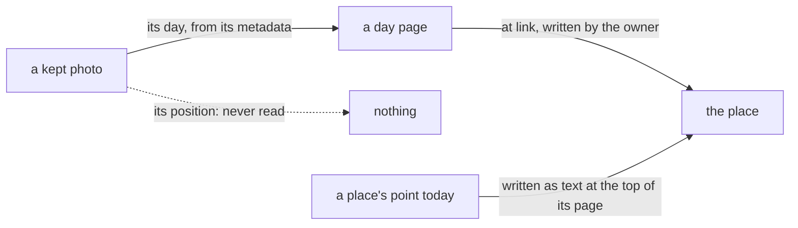

# 0016 — No location: a place has no point, and a photo's position is never read

- **Date:** 2026-10-15
- **Status:** accepted
- **Answers:** [0076](../issues/0076-a-places-point-costs-more-than-it-gives.md)

## Problem

The table `places` and the matching of a photo's position to a place answer one question the owner does not ask
the writer to answer: which place a photo was taken in. The owner names the place of a day by hand. Anything still
in the schema at the freeze stays for good.

## Options

**A. Keep the point and the matching.** No work now; the cost stays for good after the freeze.

**B. Keep the point, drop the matching.** The table stays with nothing to read it: a column kept for a question
nobody asks.

**C. Remove the point and the matching.**

- Removed from [schema.sql](../schema/schema.sql): the table `places` and its triggers `places_fixed`,
  `places_touch` and `places_no_delete`; the photo clause of the `at` note in `link_kinds`.
- Removed pages: the cookbook recipe on the place of a photo. [D21](../decisions/D21-location-history.md) becomes
  "no location"; [D16](../decisions/D16-places.md) loses the point.
- Removed from the writer: `locate`, the map of the places, the `at` and `radius` fields of `add-file` and the
  position in its answer, the folder import of photos and its groups, the position in `internal/photo`.
- Not additive, so it is possible only before the freeze. The points of the owner's places are written at the top
  of the place pages as text (`Point: lat, lon, radius m`), so no word is lost.
- Lost: a photo's place found by its position; a map of the places.

## Recommendation

Option C, as the owner decided on 2026-10-15.

## Validation

The suites change with the docs: the `places` suite and its 19 mutants go; the counts in `tests/README.md` change;
the `named` suite keeps "a place needs no detail row". `go generate ./... && go vet ./... && go test ./...` passes.
The catalog has no `locate`, and `add-file` has no `at` and no `radius`. No new SQLite behaviour is claimed.

## Outcome

Accepted 2026-10-15, option C, as the owner decided. It rewrites [D21](../decisions/D21-location-history.md) in place.
