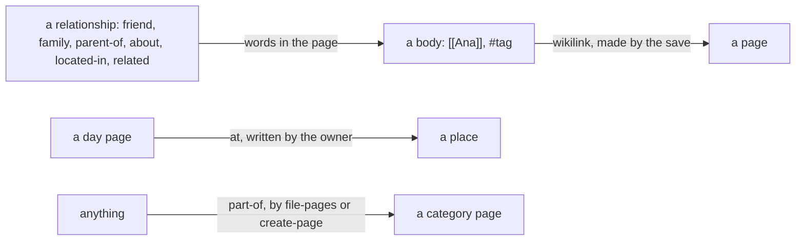

# 0017 — Three link kinds: wikilink, at and part-of; no symmetric mirror

- **Date:** 2026-10-15
- **Status:** accepted
- **Answers:** [0077](../issues/0077-relationship-links-cost-more-than-they-give.md)

## Problem

The registry holds six relationship kinds the owner does not use, and the symmetric ones bring a mirror mechanism
of their own. Anything still in the schema at the freeze stays for good.

## Options

**A. Keep the kinds.** No work now; the cost stays for good after the freeze.

**B. Remove the six kinds, keep the symmetric mechanism.** A flag, a CHECK and three triggers with no kind that
uses them: a rule without a user.

**C. Remove the kinds and the mirror.**

- Removed from [schema.sql](../schema/schema.sql): the registry rows `about`, `located-in`, `parent-of`, `friend`,
  `family` and `related`; `link_kinds.symmetric` and `link_kinds_mirror_valid`; the triggers `links_mirror_insert`,
  `links_mirror_note` and `links_mirror_delete`; the symmetric query of the integrity checks.
- Removed pages: the cookbook recipe on containment. [D8](../decisions/D08-entities-and-links.md) loses the
  mirror; [D16](../decisions/D16-places.md) loses `about` and `located-in`; the link map draws three arrows.
- Removed from the writer: the kinds in `link` and `unlink`, which keep `at`; the symmetric exclusion in the
  backlink queries; the `invalid_symmetric_links` diagnostic.
- Not additive, so it is possible only before the freeze. A link of a removed kind in `life.db` becomes a line of
  text at the top of the page it left (`friend: [[Ana]]`), so no word is lost and the wikilink keeps the pages
  joined.
- Lost: a typed relationship as a row; a symmetric edge stored in both directions.

## Recommendation

Option C, as the owner decided on 2026-10-15.

## Validation

The suites change with the docs: the `links` suite keeps the registry, the endpoint types and the immutability on
the three kinds; the `graph-model` suite models directed edges only; 17 mutants go; the counts in
`tests/README.md` change. `go generate ./... && go vet ./... && go test ./...` passes. No new SQLite behaviour is
claimed.

## Outcome

Accepted 2026-10-15, option C, as the owner decided. It rewrites [D8](../decisions/D08-entities-and-links.md) in place.
