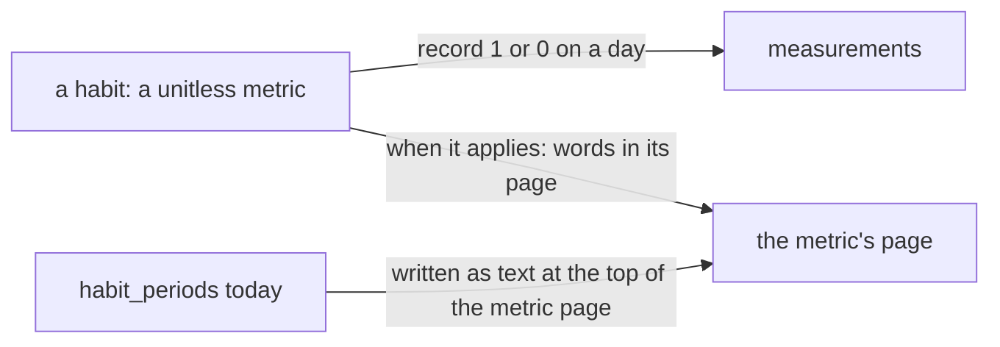

# 0018 — No habit periods: a habit is a metric with a reading of 1 or 0 a day

- **Date:** 2026-10-15
- **Status:** accepted
- **Answers:** [0078](../issues/0078-habit-periods-cost-more-than-they-give.md)

## Problem

The table `habit_periods` and the rules around it answer "was this habit meant to be done that day", a question
the owner does not ask the writer to answer. Anything still in the schema at the freeze stays for good.

## Options

**A. Keep the periods.** No work now; the cost stays for good after the freeze.

**B. Keep the table, drop the views.** A table nothing reads.

**C. Remove the periods.**

- Removed from [schema.sql](../schema/schema.sql): the table `habit_periods` and its seven triggers,
  `measurements_habit_binary`, the mention in `lifelog_meta.source`.
- Removed pages: the cookbook recipe on habits; the habit rows of the day view and of metrics by category; the two
  habit queries of the integrity checks. [D24](../decisions/D24-habits.md) becomes "no periods".
- Removed from the writer: `start-habit`, `stop-habit` and `check-in`, `register-metric`'s `habit_from`, `/habits`
  and the Habits lens of Metrics, the habits of Home, of a day and of a week with their strips, the Habits group of
  Metrics, the CLI's `habits`, `done` and `skip`.
- Not additive, so it is possible only before the freeze. The periods of the owner's habits are written at the
  top of the metric pages as text (`Habit from 2026-01-01`, `Habit from … to …`), so no word is lost.
- Lost: the writer's own answer to "not recorded" against "not a habit that day"; a completion rate; the 0/1 range
  held by a trigger.

## Recommendation

Option C, as the owner decided on 2026-10-15.

## Validation

The suites change with the docs: the `habits` suite and 40 mutants go, the integrity statements are eleven, the
cookbook has 19 recipes; the `facts` suite keeps metrics by category without the habit column. `go generate ./...
&& go vet ./... && go test ./...` passes. The catalog has no habit action. No new SQLite behaviour is claimed.

## Outcome

Accepted 2026-10-15, option C, as the owner decided. It rewrites [D24](../decisions/D24-habits.md) in place.
