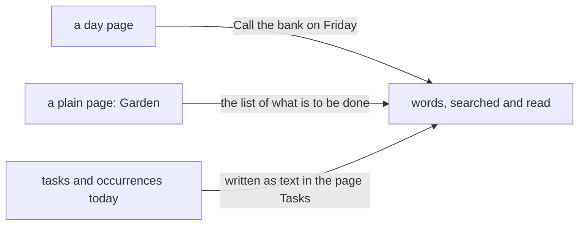

# 0019 — No tasks: a plan is words in a page

- **Date:** 2026-10-15
- **Status:** accepted
- **Answers:** [0079](../issues/0079-tasks-cost-more-than-they-give.md)

## Problem

The tables `tasks` and `task_occurrences`, the planning contract and the views over them answer "what is due", a
question the owner does not ask the writer to answer. Anything still in the schema at the freeze stays for good.

## Options

**A. Keep the tasks.** No work now; the cost stays for good after the freeze.

**B. Keep one-off tasks, drop the recurrence.** The table, the triggers, the views and the suites stay for a
list that a page holds as well.

**C. Remove the tasks.**

- Removed from [schema.sql](../schema/schema.sql): the tables `tasks` and `task_occurrences` with their indexes
  and fourteen triggers; the `lifelog_meta` row `planning`; the task clauses of the rows `schema`, `source` and
  `edit_revisions`; the task clause of the view `ghost_pages`.
- Removed pages: the planning contract and the cookbook recipe on tasks; the three task queries of the integrity
  checks. [D23](../decisions/D23-no-tasks.md) becomes "no tasks" and [D15](../decisions/D15-recurrence.md) "no
  recurrence".
- Removed from the writer: `create-task`, `edit-task`, `stop-task`, `tombstone-task`, `revive-task`,
  `tombstone-tasks`, `capture-occurrence`, `edit-occurrence`, `tombstone-occurrence`, `revive-occurrence` and
  `deadlines`; `/tasks` and `/deadlines`; the due lists of Home, of a day, of a month and of a week; the CLI's
  `tasks` and `due`; `page.task_project`.
- Not additive, so it is possible only before the freeze. The owner's tasks and their occurrences are written
  into a plain page `Tasks` as text, one line a task with its days and outcomes, so no word is lost.
- Lost: a deadline the writer knows; a reminder clock; the outcome of an occurrence as a row.

## Recommendation

Option C, as the owner decided on 2026-10-15.

## Validation

The suites change with the docs: the `planning`, `planning-boundaries` and `planning-cookbook` suites and 83
mutants go; the integrity statements are eight; the schema has 9 tables and 37 triggers. `go generate ./... &&
go vet ./... && go test ./...` passes. The catalog has no task action. No new SQLite behaviour is claimed.

## Outcome

Accepted 2026-10-15, option C, as the owner decided. It rewrites [D23](../decisions/D23-no-tasks.md) and
[D15](../decisions/D15-recurrence.md) in place.
