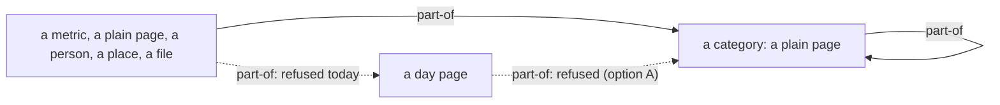

# 0020 — A day page is never filed: links_endpoint_types refuses a part-of link from it

- **Date:** 2026-10-15
- **Status:** accepted
- **Answers:** [0080](../issues/0080-a-filed-day-page-is-shown-nowhere.md)

## Problem

The schema refuses a day page as a category, but it accepts a day page filed in a category. A writer can write
that link, and a reader that keeps the days apart from the categories then shows the day page in no category and
in no count. Anything still in the schema at the freeze stays for good, and a rule added after the freeze can meet
links that a file already holds.

## Options

**A. Refuse it in the trigger.** One more statement in `links_endpoint_types`:
`SELECT RAISE(ABORT, 'a day page is never filed in a category (D26)') WHERE NEW.kind = 'part-of' AND
coalesce((SELECT is_journal FROM entities WHERE id = NEW.from_id), 0)`. The comment above the rules in the
trigger and the `part-of` note of `link_kinds` say it (the text of the `links` table does not change);
[D26](../decisions/D26-metric-categories.md) is rewritten in place; the [link rules](../architecture/link-rules.md)
and [metrics by category](../cookbook/metrics-by-category.md) cite the trigger. The `link_kinds` row keeps
`from_types` NULL: a day page and a plain page are both `page`, so the registry cannot say it.

- One other path needs a rule. A link never changes its endpoints (`links_fixed`), and a page with a name never
  becomes a day page (`entities_day_identity`, `entity_names_day_insert`). But an entity row comes before its name
  row (the foreign key of its preferred key is deferred), so in one transaction a page with no name yet can be filed,
  or made a category, and then select a date as its preferred key. `entities_day_identity` gets one more statement:
  `SELECT RAISE(ABORT, 'a page with a part-of link never becomes a day page (D26)')` when the new key is a day and
  a `part-of` link starts or ends at the page. This also closes the same path for the older rule "a category is
  never a day page".
- After the freeze it is not additive: a stricter trigger can refuse links that a file holds. Before the freeze it
  costs two statements; a file in use gets the two changed triggers by a one-off program that first lists any
  `part-of` link from or to a day page and changes nothing while one exists, so the owner decides each one.
- Redundant after it: the reader filters of the writer that left a filed day page out of a category's list and
  count.

**B. Refuse it in the writer only.** `file-pages` and `link` check the type of each page before the insert. Rejected:
a rule about the data is a CHECK or a trigger, so that every writer and every tool that writes meets it; a check
in one writer leaves the file open to every other.

**C. Keep the link, and show a filed day page in its category.** Rejected by the owner: the days stay apart from
the categories; a day is the time axis, and it is found by its date.

## Recommendation

Option A, as the owner decided on 2026-10-15: "we should block it in the schema".

## Validation

- The `links` suite: a `part-of` link from a day page is refused; from a metric, a plain page, a person and a place
  it is accepted; a day page keeps its `wikilink` and `at` links; a filed plain page cannot take a date as an alias,
  as its preferred key or as a new spelling, and a `part-of` link cannot move onto a day page.
- The `links` suite: in one transaction, a page with no name yet that is filed, or that is a category, cannot
  select a date as its preferred key; the same page with no `part-of` link can.
- Two mutants in `tests/mutants_test.go` remove the two new statements; the `links` suite notices each one
  (255 mutants).
- The writer's tests: `file-pages` that names a day page is a 422 with SQLite's sentence and writes nothing, on the
  core, on the in-process and the remote client and through MCP; a `part-of` link from a day page is a 422.
- No new SQLite behaviour is claimed: a trigger reading the generated column `is_journal` is already executed by
  the `journal` suite.

## Outcome

Accepted 2026-10-15, option A, as the owner decided. It rewrites [D26](../decisions/D26-metric-categories.md) in
place.
