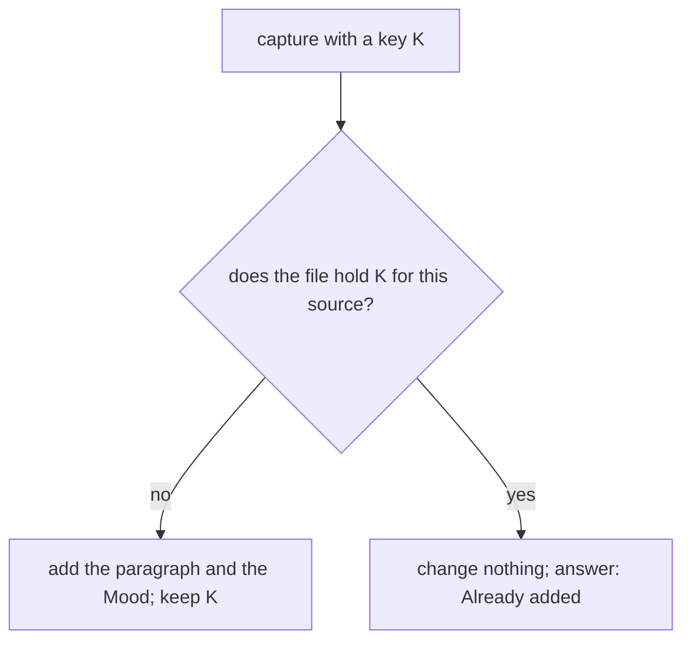

# 0021 — A capture key: the writer keeps the key of each capture it adds

- **Date:** 2026-10-17
- **Status:** accepted
- **Answers:** [0085](../issues/0085-a-resent-capture-appends-twice.md)

## Problem

A client sends a capture, the writer commits, and the reply is lost. The client cannot know that the first send
committed, so it sends the capture again. The second send appends the same paragraph to the day page and records a
second Mood reading. The body of a page has a version to compare, so a save sent again is a no-op. A capture adds to
the body and compares with nothing. Two equal captures can also be two true facts: the owner writes the same line
twice. The writer cannot tell a retry from a repeat by the content.

## Options

**A. A table that the writer keeps.** `capture_keys(id, source, import_key, page_id, recorded_at)` with
`UNIQUE (source, import_key)`. The `id` is the integer key that [D3](../decisions/D03-integer-ids.md) gives every
fact table. `page_id` references `entities(id)`: the day page of the capture. The CHECKs have
the shape of `entities_import_key` and `entities_source`, and `recorded_at` follows `lifelog_meta.instants`. The
table is append-only: two triggers refuse an UPDATE and a DELETE, because a key that changes or goes away lets the
capture be added again. A capture takes an optional `import_key`. The writer reads the key first. A row back means
that the capture was added before, so the writer changes nothing and answers with the day. Without a row, the
writer adds the capture and the key in the same transaction. The Mood reading of that capture carries the same
key in `measurements.import_key`.

- Pages touched: [schema.sql](../schema/schema.sql), the [schema page](../schema/README.md), the
  [entity model](../architecture/entity-model.md), [capture](../cookbook/capture.md),
  [import a row once](../cookbook/import-a-row-once.md).
- After the freeze: additive. It is one `CREATE TABLE` and two `CREATE TRIGGER` statements
  ([D13](../decisions/D13-migrations-and-freeze.md)). An old writer that does not know the table still captures,
  with no key, as it does today. A later change of the key shape replaces a named CHECK. A later column is
  additive. The table stays in the file for good.
- Cost: one row of about 100 bytes for each keyed capture. At ten captures a day for fifty years, that is under
  20 MB.
- Redundant after it: nothing. The `import_key` columns of `entities` and `measurements` stay as they are.

**B. A key for each paragraph and each reading, given by the client.** A paragraph is not a row: a page has one
body ([D5](../decisions/D05-pages-and-day-pages.md)), so a key for a paragraph needs a table of paragraphs. That is
a revision table by another name, which [D12](../decisions/D12-no-revision-tables.md) refuses. A key on the reading
exists already (`measurements.import_key`) and does not cover the paragraph. The client must also make and keep one
key for each part of the capture.

- After the freeze: a table of paragraphs is additive, but the body would then have two homes. Moving the body out
  of `entities` is not additive.
- Redundant after it: `entities.body` for a journal day.

**C. No key: compare the content.** The writer would refuse a capture that equals the last paragraph of the page.
Rejected: two equal captures can be two true facts, and the writer cannot tell which one it sees. A rule of this kind
loses a true fact without a sign, and a lost fact cannot be found again.

## Recommendation

Option A, as the plan of the owner's decision on 2026-10-17 says: "a durable key on every surface". The key is the
sender's, as it is for any row that may arrive twice ([import a row once](../cookbook/import-a-row-once.md)). The
writer keeps the keys it has seen, in one place, with the shape rule in the file.

## Validation

- The `journal` suite: the recipe of [capture](../cookbook/capture.md) with a key, run literally. The same key
  twice gives one paragraph and one Mood reading. Two captures with no key still append twice. Different keys give
  two paragraphs. The writer's own capture, run on the DDL under test, does the same.
- The `schema-safeguards` suite: `capture_keys_import_key` accepts 1 to 512 bytes, and refuses the empty key, a NUL
  and 513 bytes, as `entities_import_key` does. The `journal` suite: the key is unique per source, and one key under
  two sources is two rows. A row is never updated and never deleted. A page that does not exist is refused. The
  `dates` suite holds `recorded_at` to the exact-time vectors.
- Twelve mutants in `tests/mutants_test.go`, one for each new CHECK, trigger, key, reference and the key of the
  recipe (273 mutants).
- The writer's tests: the same key twice through the core, the API, the browser form, the CLI and MCP changes
  nothing the second time and answers "Already added".
- No new SQLite behaviour is claimed. `ON CONFLICT DO NOTHING` with `RETURNING` is already executed by
  [imports](../contract/imports.md).

## Outcome

Accepted 2026-10-17, option A. It becomes [D28](../decisions/D28-capture-keys.md).
