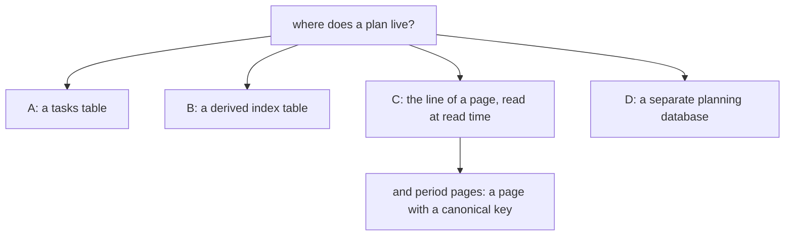

# 0022 — Plan lines and period pages: the planning axis without a table

- **Date:** 2026-10-19
- **Status:** accepted
- **Answers:** [0087](../issues/0087-a-plan-written-as-words-cannot-be-read-as-a-plan.md)

## Problem

The owner plans in words, and the words cannot be read as a plan (issue 0087). The owner wants a plan to be listed
on its day, ticked, repeated and carried, and wants a page for a week, a month, a quarter and a year. The owner has
also said that the file must stay small: [RFC 0019](../rfcs/0019-no-tasks.md) removed the task tables on
2026-10-15, five days after [RFC 0007](0007-personal-tasks-and-occurrences.md) added them.

## Options

**A. A `tasks` table.** The change is a table, occurrence rows and the triggers that keep them true, with the
actions and views of RFC 0007. It is additive after the freeze. It gives a plan an id and lets the file refuse a bad
plan. It has two homes for one fact: the words in the page and the row. RFC 0007 measured the cost: fourteen
triggers, eleven actions, and a plan that the owner had to write twice. Rejected.

**B. A derived index table.** A table `plan_lines(page_id, line, day, …)` that the writer fills from the bodies. It
is disposable, and it can be rebuilt from the bodies. It is also a table in the frozen file, and it stays in its
shape for good. It needs a rule that keeps it equal to the bodies, as `links` does for wikilinks. It is additive
after the freeze. It is not needed until a scan is slow. Deferred: the reopen trigger is below.

**C. Lines read at read time, with a grammar in the contract and period pages as canonical keys.** A plan line is a
list item of a body that starts with a box. The grammar is the page [plan lines](../contract/plan-lines.md), with
vectors. The writer reads the lines from the bodies of the pages that hold a box, and it changes a line by editing the
body. A week, a month, a quarter and a year are pages with a canonical key, as a day page is
([D30](../decisions/D30-period-pages.md)). The change to `schema.sql` is one generated column, two CHECKs, and four
widened triggers: no new table, no new trigger. After the freeze the grammar can grow by a key with no migration,
since the file does not know it. This is the owner's choice.

**D. A separate planning database.** Rejected: it splits the one file ([D1](../decisions/D01-single-sqlite-file.md)).

## Recommendation

Option C. The price, said to the owner: a rule about a line is contract text checked by the writer and the suites,
not a CHECK. Nothing in the file refuses a malformed line. A line has no id, so a tick names the line by its number
and its text, and a body edited between the read and the tick makes the tick stale.

The reopen trigger of option B is a measurement. The scan that lists the lines of a day, at the lifetime scale of
the synthetic workload, has a budget. When its measured time passes the budget of the day view, the writer gets a
derived index (option B), and the grammar stays as it is.

## Validation

- The vectors of [plan lines](../contract/plan-lines.md): the line vectors and the next-day vectors. The `plan-lines`
  suite reproduces them through the writer's parser when the parser exists ([plan 136](../plans/136-plan-lines-and-period-pages.md),
  step 2).
- The mutants of the period DDL, named by plan 136: both CHECKs, the `w` pattern, the three widened triggers, the
  `part-of` clause, and `at` left day-only.
- The document and diagram suites for the new page, the diagrams and the cookbook recipe.
- No new SQLite behaviour is claimed here beyond the date probes that the suites of plan 136 execute, and one more:
  a partial index may name a VIRTUAL generated column, and a body write moves a row in and out of it (the
  `plan-lines-index` suite).
- Measured on the lifetime fixture (74,450 live rows, 82 MB of bodies, 3,009 plan lines). Any filter on `body` reads
  every body, so the reopen trigger of plan 136 fired. The owner chose no table. The generated column `has_box` with
  the partial index `entities_plans` is the smallest derived index.

  | read | before | after |
  |---|---|---|
  | `day_view` | 0.6 ms | 0.6 ms |
  | `pagesWithBoxes` SQL, `instr(body,'[')` (19,654 rows) | 380 ms | not used |
  | the same with the five box literals (3,009 rows) | 1,600 ms | not used |
  | `planned_day` (median of 3) | 854 ms | 49 ms |
  | `plan_lines_week` (median of 3) | 844 ms | 53 ms |
  | `capture_commit` (median of 3) | 1.38 ms | 1.18 ms |
  | `save_commit` (median of 3) | 0.53 ms | 0.63 ms |

  The index costs no measurable time on a body write (the differences are inside the spread of 3 samples). The 49 ms
  that remain are the parse of the 3,009 pages with a box and the sort.

## Outcome

Accepted 2026-10-19 as [D29](../decisions/D29-plan-lines.md) and [D30](../decisions/D30-period-pages.md). It
rewrites [D23](../decisions/D23-no-tasks.md), [D15](../decisions/D15-recurrence.md),
[D5](../decisions/D05-pages-and-day-pages.md) and [D22](../decisions/D22-events.md) in place.
