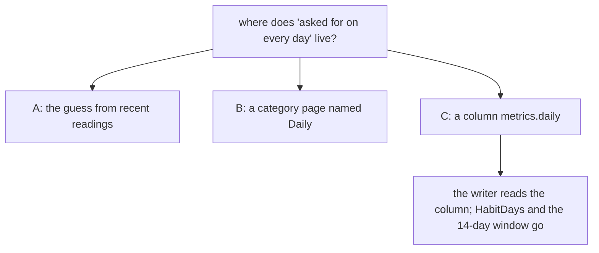

# 0023 — A daily mark on a metric: the owner says which readings the writer asks for

- **Date:** 2026-10-23
- **Status:** accepted
- **Answers:** [0090](../issues/0090-the-writer-guesses-which-metrics-are-daily.md)

## Problem

The file cannot say which metrics the owner wants a reading of on every day (issue 0090). The writer guesses from
the readings of the last 14 days. The guess never finds a metric with a unit, and it loses a habit that lapsed.

## Options

**A. Keep the guess.** No change to the file. Sleep and Mood are never asked for. A lapsed habit disappears.
Rejected: it does not answer the issue.

**B. A category page named Daily.** The writer finds the metrics filed in it by the name. Rejected. The name is a
rule in Go that the file cannot see. Another writer cannot find it. [RFC 0001](0001-metric-categories.md) already
rejected a stored habit category. Categories are the owner's pages, and the file seeds none.

**C. A column `metrics.daily`.** The column is `INTEGER NOT NULL DEFAULT 0 CHECK (daily IN (0, 1))`. It is the
metric's own, as `unit` is ([D27](../decisions/D27-a-metric-is-a-page.md)). The writer asks for a reading of a daily
metric on every day. The change is additive: a column with a default is possible after the freeze too
([D13](../decisions/D13-migrations-and-freeze.md)). It makes redundant `HabitDays` and the 14-day window of the Today
strip. It costs one column, one CHECK and one mutant.

## Recommendation

Option C. The mark cannot be derived from the readings, so the file stores it. It may change at any time. A day with
no reading still says nothing ([D24](../decisions/D24-habits.md)): the mark is a prompt, not a rule about the readings.

## Validation

- The `facts` suite labels "metrics.daily takes only 0 or 1" and "a metric's daily mark may change".
- The mutant "a metric's daily mark takes any number" in the `mutants` suite.
- The `cookbook` suite runs the block "The readings asked for on this day" of the day view.
- No new SQLite behaviour is claimed.

## Outcome

Accepted by the owner on 2026-10-23. It became [D31](../decisions/D31-daily-metrics.md).
