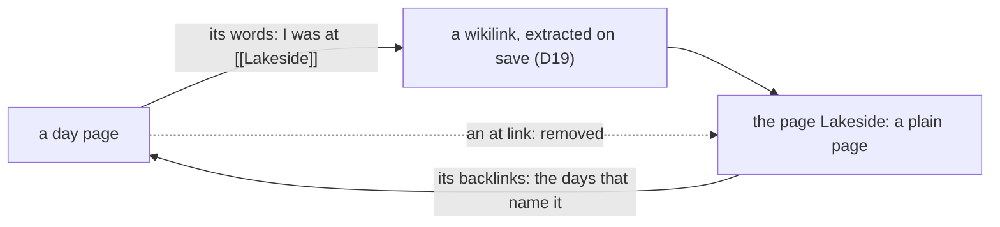

# 0024 — No places: a place is a plain page, and where a day was is the words of the day page

- **Date:** 2026-10-29
- **Status:** accepted
- **Answers:** [0091](../issues/0091-places-cost-more-than-they-give.md)

## Problem

The type `place` and the link kind `at` exist for one difference, a day that names a place against a day the owner
was at the place, and the owner's file shows that the difference is not used: of thirty places, twenty-one have no
link at all and five are linked from a day page. A place has nothing behind its type but this kind
([D21](../decisions/D21-location-history.md) took its point). Anything still in the schema at the freeze stays for good
([D13](../decisions/D13-migrations-and-freeze.md)), and the file is a freeze candidate.

## Options

**A. Keep the type and the kind.** No work now. After the freeze the type, the kind, the three actions and their
suites stay for good, used by five rows.

**B. Drop the kind `at`, keep the type `place`.** The Where box, `link` and `unlink` go. What stays is a label: a
place is then a page with a list of its own, a filter in Browse and in search, and a `create-place` action, and
nothing a plain page cannot do. A type kept for a list is the cost of A with less to show for it.

**C. Drop the type and the kind.** A place is a plain page, as a book or a topic is. Where the owner was on a day is
the words of the day page, `I was at [[Lakeside]]`, and the days at a place are the backlinks of its page
([days that name](../cookbook/days-that-name.md)), which the page already draws.

Removed from [schema.sql](../schema/schema.sql):

- `'place'` from `entities_entity_type` and from the `wikilink` row of `link_kinds`; the comment of `entities` that
  names a place.
- The `at` row of `link_kinds` and its clause in `links_endpoint_types`; the `at` sentence of the comment of `links`.
- The sentence of `entities_promote_from_page` that exists for a place alone. The trigger stays: the foreign key of a
  typed row refuses the same write, but with the sentence of a foreign key, and the trigger's sentence names the rule
  ([0081](../issues/0081-only-the-writer-keeps-a-place-a-place.md) says why a plain sentence matters).

Removed or rewritten pages: [D16](../decisions/D16-places.md) becomes "no places" and keeps its number;
[D21](../decisions/D21-location-history.md) loses the `at` link as the answer to "where was I" (the answer is the
day's words); [D8](../decisions/D08-entities-and-links.md) has four linkable types and two link kinds;
[D20](../decisions/D20-named-pages.md) is about a person. The recipe [where was I](../cookbook/where-was-i.md) goes;
[a person or a place](../cookbook/person-or-place.md) and [everything about](../cookbook/everything-about.md) are
about a person; [the day view](../cookbook/day-view.md) loses its `at` clause. The `at` check of the
[integrity checks](../contract/integrity-checks.md) and row 20 of the 2075 table of the
[threat model](../contract/threat-model.md) go; [link rules](../architecture/link-rules.md), the
[entity model](../architecture/entity-model.md), the [page lifecycle](../architecture/page-lifecycle.md), the
[product concepts](../architecture/product-concepts.md) and the location row of the
[non-goals](../architecture/non-goals.md) say the new truth; the totals line of [the schema page](../schema/README.md)
changes.

Removed from the writer: the actions `create-place`, `link` and `unlink` (the kind `at` was the only kind they took:
a wikilink comes from the body and a `part-of` from `file-pages`); the `place` option of `promote`, whose field `to`
then has one option and the action is "Make it a person"; the `place` kind of `browse`, `search` and `random`, the
Places list and its count; the Where box of a day and the place chips of a day's card; the place in the words of the
agent's instructions. The MCP tools and the forms follow the catalog. The README's table of the surfaces loses three
rows.

Not additive, so it is possible only before the freeze. Lost: a row that says "was at" apart from "names". The
owner's choice is that the words of the day say it.

The owner's file follows by a one-off program, as the cuts of [RFC 0016](0016-no-location.md) to
[0019](0019-no-tasks.md) did: with the service stopped and a snapshot taken, on a dry run first, it (1) writes
`I was at [[Place]]`, with the link's note when there is one, as a last line of each day page that has an `at` link
and does not name the place in its words already, through the save contract of [D19](../decisions/D19-wikilink-save-contract.md)
so the wikilink row follows; (2) deletes the `at` rows and then the `at` kind, which `link_kinds` allows once the
kind is unreferenced; (3) makes the thirty places plain pages, with the same ids, titles, aliases, text and backlinks,
after dropping `entities_promote_from_page`, which refuses the type change of a place on purpose; (4) brings the
stored DDL to the new `schema.sql`, byte for byte, as the earlier programs did; (5) passes the integrity checks.
No word is lost: a place's text stays its page, and a day's place becomes a sentence of the day.

## Recommendation

Option C, as the owner decided on 2026-10-29.

## Validation

The suites change with the docs: the mutants of `named`, `links` and `journal` that name a place or `at` go, and the
counts in `tests/README.md` change; the `named` suite is about a person; the `diagrams` suite keeps the link map
equal to `link_kinds`, which then has two rows; the `document` suite keeps every link resolving. The catalog has no
`create-place`, `link` or `unlink`, `promote` takes `person` alone, and `TestTheTableOfTheSurfacesIsTheCatalog` holds.
The boundary tests of `cmd/lifelog` hold. `go vet ./... && go test ./...` passes, and the end-to-end test of
`extensions/mcp` passes in its folder. No new SQLite behaviour is claimed.

## Outcome

Accepted 2026-10-29, option C, as the owner decided. It rewrites [D16](../decisions/D16-places.md) and
[D21](../decisions/D21-location-history.md) in place; the change and the one-off program follow in a plan.
