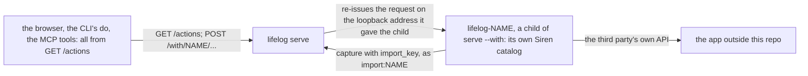

# 0025 — No plan lines: a plan lives in the owner's task manager, reached through a catalog the core aggregates

- **Date:** 2026-10-29
- **Status:** accepted
- **Answers:** [0092](../issues/0092-plan-lines-cost-more-than-they-give.md)

## Problem

A plan line ([D29](../decisions/D29-plan-lines.md)) gives a plan two homes: the task manager the owner uses, and a line
of a page the owner does not write. The file carries a generated column and a partial index for it, the writer four
actions, a resource, a parser and a Plans page, the docs a contract page with vectors, and the suites two suites and
four mutants. Anything still in the schema at the freeze stays for good ([D13](../decisions/D13-migrations-and-freeze.md)).

What is missing is the other direction. The owner wants the functionalities of outside apps aggregated "through an
extremely agnostic interface", with each integration built "in a simple modular way", and no code of a third party in
this repo. The core names no third party and dials only its own server ([plan 135](../plans/135-extensions-outside-the-core.md)):
an extension is a client of the API, and nothing lets it offer an action of its own to the agent, the CLI or the browser.

## Options

**A. Keep plan lines.** No work now. After the freeze `has_box` and `entities_plans` stay for good, for lines the owner
does not write. The task manager stays unreachable from the agent and the browser.

**B. Cut plan lines; keep period pages; an extension may serve a catalog that the core aggregates.** A plan lives
outside the file. What the owner did in the app comes back as an entry of the day: the app writes it with `capture`
and an `import_key` as `import:NAME` ([imports](../contract/imports.md)), so a second run writes nothing. The agent,
the CLI and the browser reach the app through the one catalog: an extension run under `lifelog serve --with NAME`
may serve its own Siren API on the loopback address the server gives it; the server reads its `GET /actions` once per
start and lists its actions in its own catalog as `NAME-action`, at `/with/NAME/...`, and re-issues each request to
the child. The CLI's `do`, the MCP tools and the browser's forms are generated from the catalog, so the app reaches
every surface with no domain code in the core. The core still names no third party: the interface is the catalog, and
the task vocabulary is the app's own. A period page ([D30](../decisions/D30-period-pages.md)) stays as a plain page
with a key, made with `create-page`, the home of a review.

Removed from [schema.sql](../schema/schema.sql): the generated column `entities.has_box` and the index
`entities_plans`; "a plan or" from the comment of `entities` that names a period page. No table, CHECK, trigger or
`lifelog_meta` row exists for a plan line, so the totals of [the schema page](../schema/README.md) do not change.

Removed or rewritten pages: [plan lines](../contract/plan-lines.md) and [plan a project](../cookbook/plan-a-project.md)
go. [D29](../decisions/D29-plan-lines.md) is rewritten in place as "no plan lines: a plan lives outside the file"
and keeps its number (the decisions are D01..Dn without a gap); [D23](../decisions/D23-no-tasks.md) says the same from
the side of the tables; [D15](../decisions/D15-recurrence.md) keeps "no recurrence table" and loses the `every:`
token; [D30](../decisions/D30-period-pages.md) and [D22](../decisions/D22-events.md) lose their plan sentences; the
[goals](../architecture/goals-and-principles.md), the [non-goals](../architecture/non-goals.md),
[imports](../contract/imports.md), [building a writer](../guides/building-a-writer.md), the freeze checklist of
[the process](../process.md) and the research section on plans as lines of text say the new truth.

Removed from the writer: the actions `plan`, `tick`, `carry` and `schedule`, the resource `plans`, the parser, the
Plans page, the box glyphs and the tick forms of every body, the plan blocks of a day, a week, a month, a year and a
period page, the `lifelog plan` line, the `plans` icon. The MCP tools and the forms follow the catalog. The README's
table of the surfaces loses five rows.

Added to the writer: the merged catalog, the `/with/{name}` routes, two error codes (`unavailable`, 503: the app is not
running; `upstream`, 502: the app answered something that is not an entity), one rail entry per connected app, and a
small public package `lifelog/app` a connector in Go imports to listen where the server says and to serve a catalog
from a few handlers. The protocol is written in [the contract of an extension](../../extensions/README.md) and in
[API.md](../../API.md), so a connector in any language works.

Not additive, so it is possible only before the freeze. Lost: a box in a body that the browser draws as a button. A
`- [ ]` line stays as the prose it is.

The owner's file follows by a one-off program, as the cuts of [RFC 0016](0016-no-location.md) to
[0024](0024-no-places.md) did: with a snapshot taken, on a dry run first, it drops `entities_plans`, then the column
`has_box`, brings the stored DDL to the new `schema.sql` byte for byte, and passes the integrity checks. No row
changes.

**C. Cut plan lines and period pages.** As B, and [D30](../decisions/D30-period-pages.md) goes too: no week, month,
quarter or year page. Rejected by the owner: a period page is the home of a review, and the live file may hold such
pages already.

**D. Task actions in the core that call a configured provider.** The core would gain `tasks`, `add-task`,
`complete-task` and a protocol of its own for a "task provider". Rejected: it names a domain in the core, and each
new kind of app would need its own actions there. The catalog is already the agnostic interface.

## Recommendation

Option B, as the owner decided on 2026-10-29.

## Validation

The suites change with the docs: `plan-lines` and `plan-lines-index` go with their four mutants, and the counts in
`tests/README.md` change (eight diagrams, 284 broken copies); the `document` suite keeps every link resolving and the
decisions without a gap. One SQLite behaviour is claimed and must be executed before the one-off is written: a VIRTUAL
generated column named by the WHERE of a partial index cannot be dropped while the index exists, and is dropped once
the index is gone, with the rows unchanged (a probe of the `evolution` suite). The catalog has no `plan`, `tick`,
`carry`, `schedule` or `plans`, and `TestTheTableOfTheSurfacesIsTheCatalog` holds on the static catalog. The
boundary tests of `cmd/lifelog` hold with one named exception: the file that re-issues a request to a child may call
`client.Remote`, and `ticktick` joins the words the core never says. An end-to-end test runs the real
`lifelog serve --with` on a test app of this repo that serves a tiny catalog: its action is in `GET /actions`, the
CLI's `do` runs it, an agent is refused its owner-only action, the browser draws its form, and a stopped app answers
503. `go vet ./... && go test ./...` passes, and the end-to-end test of `extensions/mcp` passes in its folder.

## Outcome

Accepted 2026-10-29, option B, as the owner decided. It rewrites [D29](../decisions/D29-plan-lines.md),
[D23](../decisions/D23-no-tasks.md), [D15](../decisions/D15-recurrence.md) and [D30](../decisions/D30-period-pages.md)
in place; the change and the one-off program are [plan 154](../plans/154-connected-apps-through-the-catalog.md).
