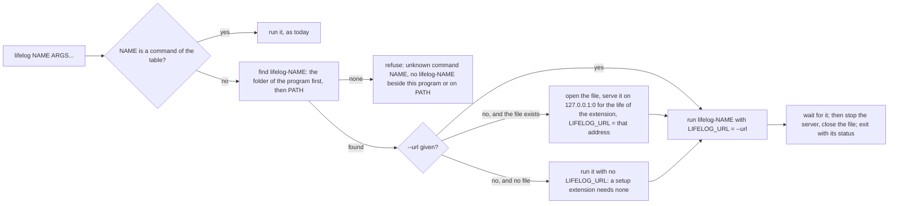
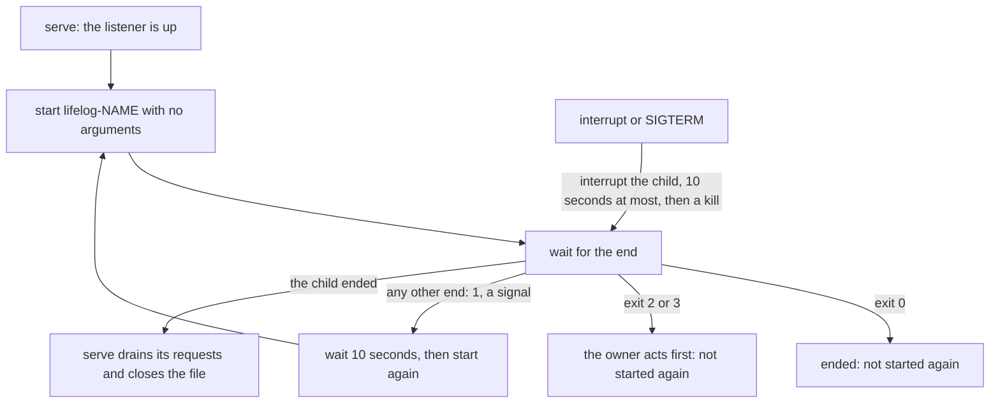
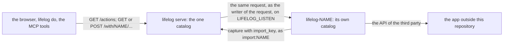
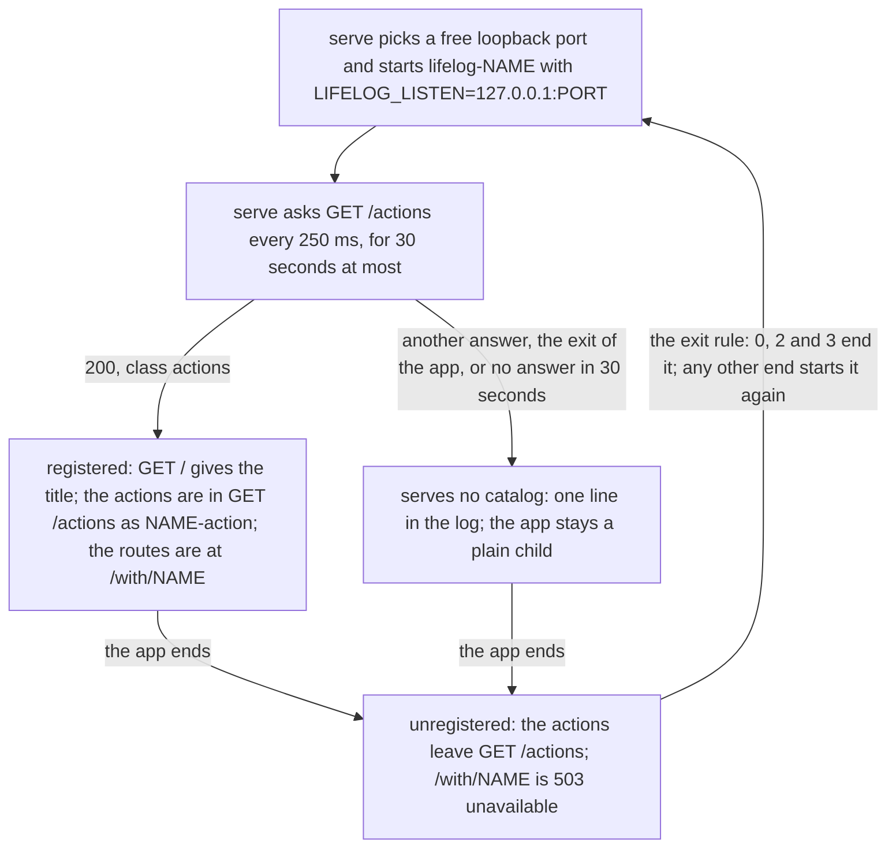
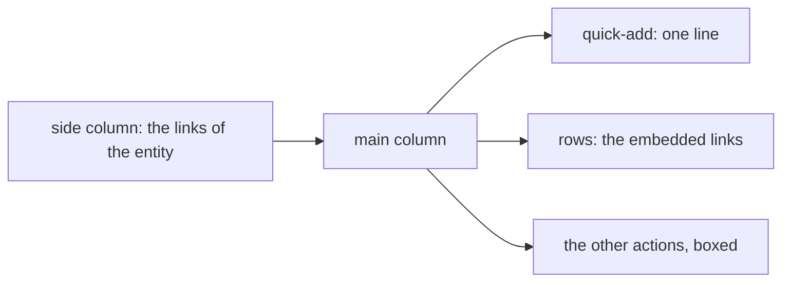
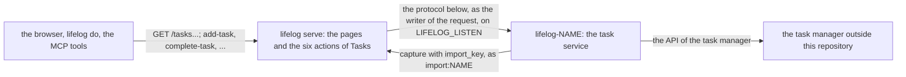
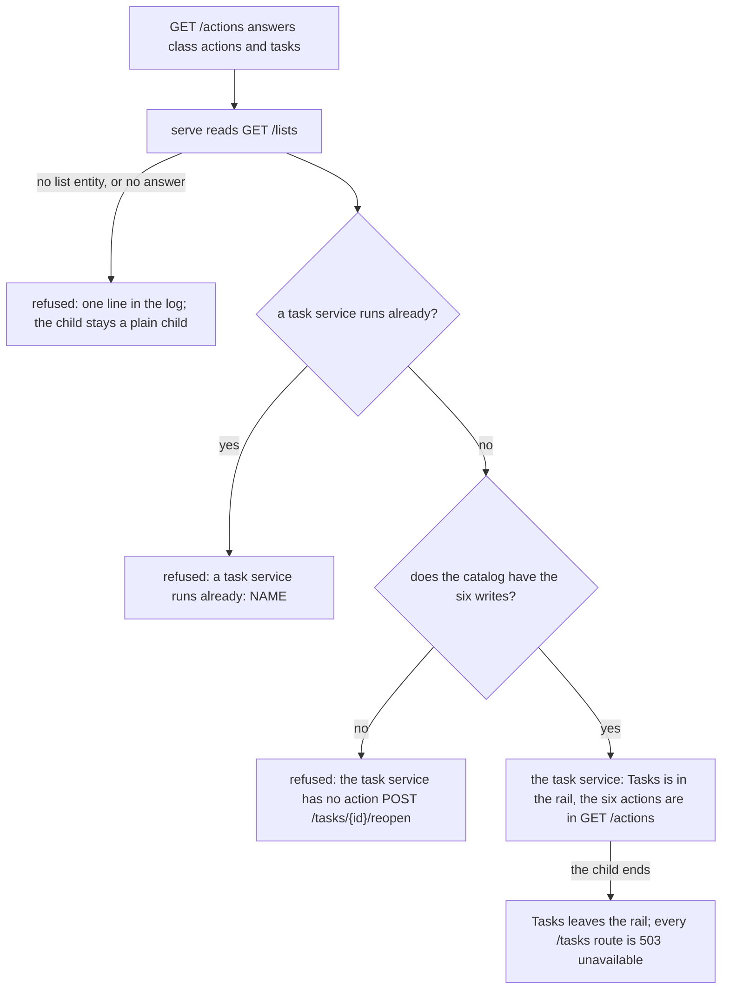

# Extensions

An extension is a program that extends `lifelog` from the outside. It is a client of [API.md](../API.md), written in
any language. It may also serve a catalog of its own ([a catalog of its own](#a-catalog-of-its-own)). The core names no
third party: an extension does.

[`googlephotos`](googlephotos/README.md) is the worked example. Read its code and its end-to-end test first.
[`ticktick`](ticktick/README.md) is the task service, and the worked example of [a task service](#a-task-service).

## What an extension is

- It lives in its own folder under `extensions/`, with its own module and its own `README.md` that gives its build line.
- It never imports `lifelog/internal`: Go refuses it. In Go it requires `lifelog v0.0.0` with `replace lifelog => ../..`
  and imports `lifelog/siren`, `lifelog/client` and, for the tools of a model, `lifelog/client/tools`.
  `go mod verify` reports `lifelog v0.0.0: missing ziphash`: a directory replace has no zip, and this is not a fault; `go mod tidy -diff` is the check that the module files are in order.
- It never opens `life.db`. There is one writer per file. The extension reads and writes through the HTTP API.
- It keeps its own state (a token, a cursor) in its own folder under the user's configuration folder, for example
  `os.UserConfigDir()/lifelog-NAME/`. It never keeps state in `life.db`.
- In Go, it uses the standard library unless a protocol needs an SDK.
- A page or a catalog that it serves listens on a loopback address only.

## The command line

`lifelog NAME [ARGS...]` runs the program `lifelog-NAME` (`lifelog-NAME.exe` on Windows). A name that is a command of
`lifelog` is that command and never an extension.

- **The search.** The folder of the program comes first, with symbolic links resolved. Then `PATH`. So the extension that
  the owner installed beside `lifelog` wins over a program on `PATH`. A program on `PATH` runs with the owner's rights,
  as a `git-NAME` does.
- **The line.** Before `NAME`, `lifelog` reads its global flags as for any command. After `NAME`, `lifelog` reads only
  `--db` and `--url` (as `--db X` or `--db=X`). It passes every other word to the extension as it is, in its order. So
  an extension may have a flag of any name.
- **Refused flags.** `--source` and `--human` before `NAME` are refused. An extension names its own writer and prints
  its own output.

## What the extension receives

| item | value |
|---|---|
| `LIFELOG_URL` | With `--url`: that URL. Else, when the file exists: the address of a temporary server on `127.0.0.1`, which lives as long as the extension. Else: not set. |
| `LIFELOG_EXE` | The path of the `lifelog` program, symbolic links resolved. |
| `LIFELOG_DB` | The absolute path of the file that the line names (`--db`, `$LIFELOG_DB`, or the `life.db` beside the program). It is set whether the file exists or not. |
| `LIFELOG_TOKEN` | As inherited. Send it as a bearer token when it is set. |
| `LIFELOG_LISTEN` | Set by `serve --with` only: the loopback address (`127.0.0.1:PORT`) where a connected app serves its catalog. The address is new at each start. A program that serves nothing ignores it. |
| stdin, stdout, stderr | Inherited. An MCP server on stdio works. |

The temporary server is the same writer as the CLI. [Connections](../docs/contract/connections.md) allows it beside
the service. A setup extension needs no server, and a client extension that has no `LIFELOG_URL` and no `--url` must refuse with a
line that says what to run. It never guesses an address: `127.0.0.1:7777` may be the server of another file.

## Exit and signals

- The exit status of `lifelog` is the status of the extension. `lifelog` writes no second message.
- An interrupt or SIGTERM reaches `lifelog` and the extension. `lifelog` sends the extension an interrupt (on Windows:
  a kill), waits for it for ten seconds at most, then stops the server and closes the file.

## Run by serve

`lifelog serve --with NAME` (repeatable) runs the extension as a child of the server and keeps it running.

- **The environment** is the one above. `LIFELOG_URL` is the address of the listener on the loopback
  (`http://127.0.0.1:PORT`, also for a listener on every interface). `LIFELOG_TOKEN` is the token of a `--public`
  listener. `LIFELOG_EXE` and `LIFELOG_DB` are as for any extension. `LIFELOG_LISTEN` is a loopback address
  (`127.0.0.1:PORT`), new at each start, on which the extension may serve a catalog
  ([a catalog of its own](#a-catalog-of-its-own)).
- **No arguments, and an empty stdin** (`/dev/null`). The extension configures itself from the settings of the API.
- **Its state folder must be writable under the unit.** A unit with `ProtectHome=read-only` lists
  `os.UserConfigDir()/lifelog-NAME` in `ReadWritePaths`, else the extension fails at its start and `serve` starts it
  again every 10 seconds.
  stdout and stderr are those of the server, so the lines go to its log.
- **The exit status** decides. 0: the extension ended by its own choice, and is not started again. 2 or 3: the owner
  must act first (for example pair a device); it is not started again until `serve` starts again. Any other end (1, a
  signal, a crash): `serve` starts it again after 10 seconds. `serve` logs each start and each end.
- **The stop.** On an interrupt or SIGTERM, `serve` interrupts the child first and waits for it, 10 seconds at most,
  then kills it. Then it drains its own requests and closes the file, so the child may still write while it ends.
- `--with` and `--tls-cert` together are refused: the child would have to trust the certificate.
- **A catalog of its own.** A child may serve a Siren catalog on `LIFELOG_LISTEN`: see [a catalog of its own](#a-catalog-of-its-own).
- **A task service.** One child may be the task service, which `lifelog` draws under `/tasks`: see [a task service](#a-task-service).

## A catalog of its own

An extension that `serve --with NAME` runs may serve a catalog of its own. It is then a connected app. The server
merges the actions of the app into its own `GET /actions`, and it forwards the requests for them to the app. The
server names no app and no domain: the catalog of the app is the whole interface. A connector in any language
implements this section and nothing else of `lifelog`.

### The handshake

- **The address is new at each start.** A restart never meets the address of the app that ended. The server chooses the
  address and probes that one. It does not read the output of the app. An app that serves nothing ignores
  `LIFELOG_LISTEN`.
- **The catalog is read again at each start.** An app that ended has no actions in the catalog.
- **The address is a loopback address.** The app listens on no other. The server calls it and nothing else does.
- **A catalog is refused as a whole** (one line in the log, and the app stays unregistered) when:
  a name of an action is not `[a-z0-9-]+`; an `href` is not a path (it must start with one `/` and have no scheme,
  host, query or fragment); `NAME-` and the name of an action is the name of an action of the server or of another app;
  or an action has a field of the type `file`. A multipart body is not forwarded.

### What the app serves

All answers are Siren JSON ([API.md](../API.md#the-entity)). The app answers `GET` and the method of each action.

| route | answer |
|---|---|
| `GET /actions` | An entity of class `actions`. Its `actions` are the actions of the app. Each has `name`, `title`, `description`, `method`, `href` and `fields`, and may have a `class` ([API.md](../API.md#action-classes)). |
| `GET /` | The home of the app. Its `title` names the app in the rail of the browser. Without a title, the name is the title. |
| one route for each action | The `method` and the `href` of the action. The answer is an entity. |
| any other route | A read of a resource that the entities of the app link to. The server forwards a `GET` that matches no action as it is. |

An `href` is templated: `/items/{id}` has a path field `id`. A field has `name`, `type`, `title`, `required`,
`options`, `in` and `value`, as in [API.md](../API.md#the-entity). `in: "path"` marks a field of the `href`. Two marks
of an action have an effect on the server:

- `owner: true`: the server refuses the action to an `agent:*` or `import:*` writer (403 `forbidden`) and never calls the
  app. The server holds this rule. The app does not check the writer.
- `danger: true`: a client warns before it sends the action.

An error is an entity of class `error` with the properties `status`, `code` and `message`, and the HTTP status of
`status`. The server passes it on with the same status and code. Any other answer to a call of the server is a fault
of the app (502 `upstream`).

### How the browser draws a page of an app

The browser draws the page of an app with its generic view. The view reads the shape of the entity and the `class` of
its actions ([API.md](../API.md#action-classes)). It reads no name of an app. A server drops a class that
`siren.ActionClasses()` does not list, so an unknown class is the same as none. An author shapes the page with three rules.

1. **Quick-add.** On a page under `/with/NAME` or `/tasks`, the first action of the entity that has the class `create`,
   writes (not a `GET`), has no path field and has exactly one required field, of the type `text`, is one line at the top of the main column: that field, the button with the
   title of the action, and the other fields folded under "More fields". The Actions section does not draw it again.
2. **Rows.** Each embedded link is a row. An embedded link may carry `properties` and `actions`
   ([API.md](../API.md#the-entity)). An action of the row that has the class `toggle` and no field is a small round button before the
   title. Its `title` is the accessible name of the button. Any other action is a boxed form after the title.
   The scalar properties of the row (a string, a number, a boolean that is true) are chips after the title, each as
   `name: value`. A row with no properties and no actions is the link and its `rel`. A form of a row returns to the
   page it is on.
3. **Two panes.** On a wide screen the links of the entity, except `self`, are a side column beside the main column.
   The link whose path is the path of the page is marked current. On a narrow screen they are a row under the title.

The scalar properties of the entity itself are one quiet line under its title, each as `name: value`; an object or a
list stays a panel. A `create` action that is not the quick-add is a button of the head, an `edit` action whose one
field is `title` is a pencil beside the title, and any other action is in the ⋯ menu.

### What the server does with a request

The route is `/with/NAME` and everything under it, for every method. The path after `/with/NAME` is the `href` of the
action, with the path fields filled.

| step | rule |
|---|---|
| the writer | The server calls the app with the header `Lifelog-Source` of the request. The app sees no cookie and no token of the server. |
| the fields | The server sends the fields that the action names. A field that the action does not name, a missing required field or a value outside `options` is refused by the server (422 `invalid`), as for every action of the catalog. The fields `back`, `feedback` and `new` of a browser never reach the app. |
| the owner | An `owner: true` action is refused to an `agent:*` or `import:*` writer (403). The app is not called. |
| the answer | The `href` of each link, embedded entity and action gets the prefix `/with/NAME`. Each action name gets the prefix `NAME-`. A link or action whose `href` has a scheme or a host is dropped: nothing the app says leads off the server. |
| a browser | A `POST` from a browser is answered with a redirect to the `self` link of the answer, with the toast of the server. A `GET` is drawn by the generic view of the browser. |
| no retry | The server sends a request once. A write that was sent may be done, and the caller decides. |
| the time | The server waits 30 seconds for the app. A slow app is 504 `timeout`. |
| the errors | An app that does not run is 503 `unavailable` with `Retry-After`. An unknown app is 404. An answer that is not an entity is 502 `upstream`. The error entity of the app passes with its status. |

The rail of the browser has one entry for each app that runs, titled by its home. A phone shows the apps in the More
sheet. `lifelog do NAME-action field=value` and the MCP tool `NAME_action` follow from the merged catalog. An owner-only
action is no MCP tool. Both need the address of a running `serve` (`--url`): the in-process CLI and the temporary
server of `lifelog NAME` run no child, so they have no app.

### What the app writes back

What the owner did in the app comes back as entries of the journal. The app calls the API with `capture`, with an
`import_key` for each entry, as `import:NAME` ([imports](../docs/contract/imports.md)). A second run of the connector
writes nothing that it wrote before. The app uses `LIFELOG_URL` and `LIFELOG_TOKEN` as any extension does. It polls the
third party on a timer of its own, and it writes through the API and never into the file.

### State and credentials

The app keeps its state in `os.UserConfigDir()/lifelog-NAME/`, with mode `0700`, as any extension does. A secret of the
third party lives there and nowhere else: not in the settings of `lifelog`, not in `life.db`. The step that makes it is
a command of the connector, `lifelog NAME login`, which the owner runs once. A connector that cannot go on until the
owner acts (the login is missing) ends with status 2, so `serve` does not start it again every 10 seconds.

### In Go: the package `lifelog/app`

The package `lifelog/app` serves a catalog and never dials. `Listen(ctx, handler)` serves on `LIFELOG_LISTEN`, refuses an
unset value or an address that is not a loopback address, and drains on the end of `ctx`. `Catalog(title, home, actions,
handlers)` is the handler (`CatalogOf(role, ...)` adds a role to the class of `GET /actions`; the role `tasks` marks the [task service](#a-task-service)): it serves `GET /actions`, `GET /` and one route for each action, and it panics at the start
when an action has no handler. `Fail` writes an error entity. `StateDir(name)` makes the state folder. `ExitOwnerActs`
is 2. [`cmd/lifelog/testdata/withapp/main.go`](../cmd/lifelog/testdata/withapp/main.go) is the whole example, and
`cmd/lifelog/with_app_test.go` runs it on the real `lifelog serve --with`. An app in another language serves the same
routes with any HTTP library.

## A task service

One child of `serve --with` may be the **task service**: the program that stands for the task manager the owner plans
in. `lifelog` builds the pages and the forms of Tasks, and the service is a small data adapter. The server does not know
which task manager it is. Only one task service runs at one time. The file keeps no task
([D23](../docs/decisions/D23-no-tasks.md)). The routes and the actions that a client sees are in
[API.md](../API.md#tasks).

### The marker and the refusals

The service is an app that serves a catalog ([the handshake](#the-handshake)) with one difference: the `class` of
`GET /actions` is `actions` **and `tasks`**. The server then reads `GET /lists` and registers the child as the task
service, not as an app: it has no `/with/NAME`, no entry in the rail and no action with the prefix `NAME-`.

The catalog must hold an action with the method `POST` and each of these `href` values (the names are the service's
own; the server calls the `href`, not the name): `/tasks`, `/tasks/{id}`, `/tasks/{id}/complete`,
`/tasks/{id}/reopen`, `/tasks/{id}/delete` and `/sync`. A catalog that lacks one is refused. The lists are read once,
when the service registers: a new list needs a restart of the service.
An app whose prefixed action name is one of the six names of [API.md](../API.md#tasks) is refused too.

### The protocol

All answers are Siren JSON. Data is in `properties`. An error is the error entity, as for any app.

| route | answer |
|---|---|
| `GET /actions` | Class `actions` and `tasks`. The actions are the six writes below. |
| `GET /lists` | `properties.lists`: `[{id, name}]` in the order of the service. The default list may be absent. |
| `GET /open[?list=ID]` | `properties.tasks`: the open tasks, in the order of the service. |
| `GET /done?since=YYYY-MM-DD[&list=ID]` | `properties.tasks`: the tasks done on that day or later. |
| `GET /tasks/{id}` | Class `task`, `properties` = one task. An unknown id is 404 `not_found`. |
| `POST /tasks` | Fields `title` (required), `list` (an id; absent means the default list), `due` (a day), `notes`. Answer: the task. |
| `POST /tasks/{id}` | Edit: `title`, `notes`, `due`. A field that is not sent stays as it is. An empty `due` or `notes` clears it. |
| `POST /tasks/{id}/complete`, `/reopen`, `/delete` | Answer: the task (delete: the task as it was). |
| `POST /sync` | Read the done tasks and write a Done entry for each, once. Answer: `properties.written`. |

A list id must be unique: the server refuses a service with two lists of one id. A later list whose name is taken gets
the suffix ` (2)`, ` (3)`, and so on, because `add-task` names a list by its name.

A task is `{id, title, list, notes?, due?, done, done_day?, done_at?}`:

- `list` is the list id, or `""` for the default list.
- `due` and `done_day` are days (`YYYY-MM-DD`) in the zone of the task.
- `done_at` is an RFC 3339 instant.

`lifelog` sorts and filters: the service need not. Today is the day of the owner's clock in `lifelog`, and the window of
Done (30 days) is sent as `since`. There is no priority in the protocol. The service writes its Done entries as any app
does ([what the app writes back](#what-the-app-writes-back)).
[`cmd/lifelog/testdata/taskservice/main.go`](../cmd/lifelog/testdata/taskservice/main.go) is the whole example, in Go with
`app.CatalogOf("tasks", ...)`, and `cmd/lifelog/tasks_test.go` runs it on the real `lifelog serve --with`.

## Who writes

An extension writes as `import:NAME` (an importer) or `agent:NAME` (a model), with the header
`Lifelog-Source: import:NAME` or `Lifelog-Source: agent:NAME`. The owner-only actions are refused to such a writer by
the rule that exists already ([API.md](../API.md)). `GET /actions` of the server is the catalog of the actions.

## Tests

- Use synthetic data. Fake the third party.
- Build the real `lifelog` for an end-to-end test: `go build -C ../.. -o $TMP/lifelog ./cmd/lifelog`.
- Do not open the owner's `life.db`.

## The extensions

| folder | binary | command line | writes as | needs the server |
|---|---|---|---|---|
| `extensions/googlephotos` | `lifelog-gphotos` | `lifelog gphotos [--addr A] [--credentials F] [--zone Z]` | `import:google-photos` | yes |
| `extensions/agentic` | `lifelog-agentic-init` | `lifelog agentic-init [--force]` | nothing | no: it reads `LIFELOG_EXE` and `LIFELOG_DB`, and refuses to run without them |
| `extensions/mcp` | `lifelog-mcp` | `lifelog mcp [--agent NAME]` | `agent:NAME`, default `agent:mcp` | yes: `LIFELOG_URL`, else `--url`, else it refuses; `--source` is refused as today |
| `extensions/ticktick` | `lifelog-ticktick` | `lifelog ticktick login`, `lifelog ticktick sync [--url U]`, and `lifelog serve --with ticktick` (the always-on way, as the task service) | `import:ticktick` | yes: `LIFELOG_URL`, else `--url`, else it refuses; `login` needs none |
| `extensions/whatsapp` | `lifelog-whatsapp` | `lifelog serve --with whatsapp` (the always-on way), `lifelog whatsapp login` and `lifelog whatsapp [--terminal] [--url U] [--token-file F]` (the number is the setting `owner_number`) | `agent:whatsapp` | yes: `LIFELOG_URL`, else `--url`, else it refuses; `login` needs none |
