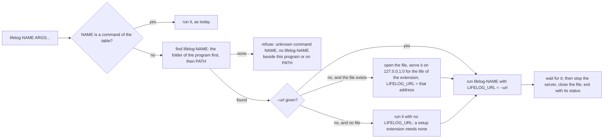
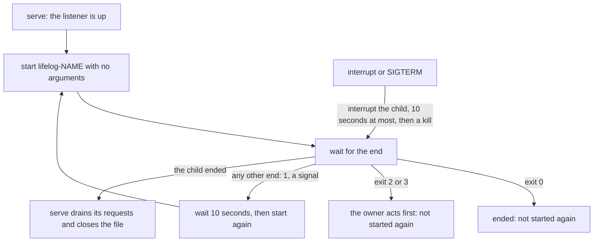

# Extensions

An extension is a program that extends `lifelog` from the outside. It is a client of [API.md](../API.md), written in
any language. The core names no third party: an extension does.

[`googlephotos`](googlephotos/README.md) is the worked example. Read its code and its end-to-end test first.

## What an extension is

- It lives in its own folder under `extensions/`, with its own module and its own `README.md` that gives its build line.
- It never imports `lifelog/internal`. A nested Go module cannot.
- It never opens `life.db`. There is one writer per file. The extension reads and writes through the HTTP API.
- It keeps its own state (a token, a cursor) in its own folder under the user's configuration folder, for example
  `os.UserConfigDir()/lifelog-NAME/`. It never keeps state in `life.db`.
- In Go, it uses the standard library unless a protocol needs an SDK.
- A page that it serves listens on a loopback address only.

## The command line

`lifelog NAME [ARGS...]` runs the program `lifelog-NAME` (`lifelog-NAME.exe` on Windows). A name that is a command of
`lifelog` is that command and never an extension.

- **The search.** The folder of the program comes first, with symbolic links resolved. Then `PATH`. So the extension that
  the owner installed beside `lifelog` wins over a program on `PATH`. A program on `PATH` runs with the owner's rights,
  as a `git-NAME` does.
- **The line.** Before `NAME`, `lifelog` reads its global flags as for any command. After `NAME`, `lifelog` reads only
  `--db` and `--url` (as `--db X` or `--db=X`). It passes every other word to the extension as it is, in its order. So
  an extension may have a flag of any name.
- **Refused flags.** `--source` and `--human` before `NAME` are refused. An extension names its own writer and prints
  its own output.

## What the extension receives

| item | value |
|---|---|
| `LIFELOG_URL` | With `--url`: that URL. Else, when the file exists: the address of a temporary server on `127.0.0.1`, which lives as long as the extension. Else: not set. |
| `LIFELOG_EXE` | The path of the `lifelog` program, symbolic links resolved. |
| `LIFELOG_DB` | The absolute path of the file that the line names (`--db`, `$LIFELOG_DB`, or the `life.db` beside the program). It is set whether the file exists or not. |
| `LIFELOG_TOKEN` | As inherited. Send it as a bearer token when it is set. |
| stdin, stdout, stderr | Inherited. An MCP server on stdio works. |

The temporary server is the same writer as the CLI. [Connections](../docs/contract/connections.md) allows it beside
the service. A setup extension needs no server, and a client extension that has no `LIFELOG_URL` and no `--url` must refuse with a
line that says what to run. It never guesses an address: `127.0.0.1:7777` may be the server of another file.

## Exit and signals

- The exit status of `lifelog` is the status of the extension. `lifelog` writes no second message.
- An interrupt or SIGTERM reaches `lifelog` and the extension. `lifelog` sends the extension an interrupt (on Windows:
  a kill), waits for it for ten seconds at most, then stops the server and closes the file.

## Run by serve

`lifelog serve --with NAME` (repeatable) runs the extension as a child of the server and keeps it running.

- **The environment** is the one above. `LIFELOG_URL` is the address of the listener on the loopback
  (`http://127.0.0.1:PORT`, also for a listener on every interface). `LIFELOG_TOKEN` is the token of a `--public`
  listener. `LIFELOG_EXE` and `LIFELOG_DB` are as for any extension.
- **No arguments, and an empty stdin** (`/dev/null`). The extension configures itself from the settings of the API.
- **Its state folder must be writable under the unit.** A unit with `ProtectHome=read-only` lists
  `os.UserConfigDir()/lifelog-NAME` in `ReadWritePaths`, else the extension fails at its start and `serve` starts it
  again every 10 seconds.
  stdout and stderr are those of the server, so the lines go to its log.
- **The exit status** decides. 0: the extension ended by its own choice, and is not started again. 2 or 3: the owner
  must act first (for example pair a device); it is not started again until `serve` starts again. Any other end (1, a
  signal, a crash): `serve` starts it again after 10 seconds. `serve` logs each start and each end.
- **The stop.** On an interrupt or SIGTERM, `serve` interrupts the child first and waits for it, 10 seconds at most,
  then kills it. Then it drains its own requests and closes the file, so the child may still write while it ends.
- `--with` and `--tls-cert` together are refused: the child would have to trust the certificate.

## Who writes

An extension writes as `import:NAME` (an importer) or `agent:NAME` (a model), with the header
`Lifelog-Source: import:NAME` or `Lifelog-Source: agent:NAME`. The owner-only actions are refused to such a writer by
the rule that exists already ([API.md](../API.md)). `GET /actions` of the server is the catalog of the actions.

## Tests

- Use synthetic data. Fake the third party.
- Build the real `lifelog` for an end-to-end test: `go build -C ../.. -o $TMP/lifelog ./cmd/lifelog`.
- Do not open the owner's `life.db`.

## The extensions

| folder | binary | command line | writes as | needs the server |
|---|---|---|---|---|
| `extensions/googlephotos` | `lifelog-gphotos` | `lifelog gphotos [--addr A] [--credentials F] [--zone Z]` | `import:google-photos` | yes |
| `extensions/agentic` | `lifelog-agentic-init` | `lifelog agentic-init [--force]` | nothing | no: it reads `LIFELOG_EXE` and `LIFELOG_DB`, and refuses to run without them |
| `extensions/mcp` | `lifelog-mcp` | `lifelog mcp [--agent NAME]` | `agent:NAME`, default `agent:mcp` | yes: `LIFELOG_URL`, else `--url`, else it refuses; `--source` is refused as today |
| `extensions/whatsapp` | `lifelog-whatsapp` | `lifelog serve --with whatsapp` (the always-on way), `lifelog whatsapp login` and `lifelog whatsapp [--terminal] [--url U] [--token-file F]` (the number is the setting `owner_number`) | `agent:whatsapp` | yes: `LIFELOG_URL`, else `--url`, else it refuses; `login` needs none |
