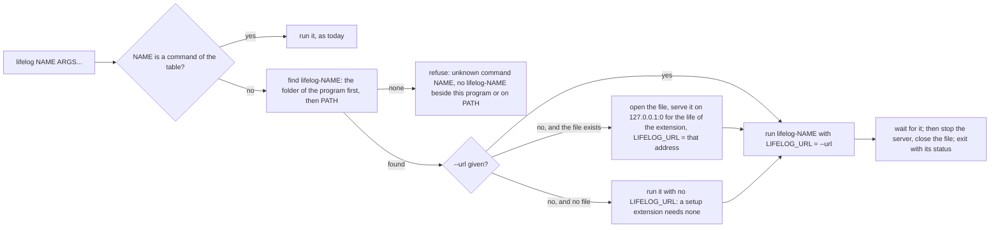

# Extensions

An extension is a program that extends `lifelog` from the outside. It is a client of [API.md](../API.md), written in
any language. The core names no third party: an extension does.

[`googlephotos`](googlephotos/README.md) is the worked example. Read its code and its end-to-end test first.

## What an extension is

- It lives in its own folder under `extensions/`, with its own module and its own `README.md` that gives its build line.
- It never imports `lifelog/internal`. A nested Go module cannot.
- It never opens `life.db`. There is one writer per file. The extension reads and writes through the HTTP API.
- It keeps its own state (a token, a cursor) in its own folder under the user's configuration folder, for example
  `os.UserConfigDir()/lifelog-NAME/`. It never keeps state in `life.db`.
- In Go, it uses the standard library unless a protocol needs an SDK.
- A page that it serves listens on a loopback address only.

## The command line

`lifelog NAME [ARGS...]` runs the program `lifelog-NAME` (`lifelog-NAME.exe` on Windows). A name that is a command of
`lifelog` is that command and never an extension.

- **The search.** The folder of the program comes first, with symbolic links resolved. Then `PATH`. So the extension that
  the owner installed beside `lifelog` wins over a program on `PATH`. A program on `PATH` runs with the owner's rights,
  as a `git-NAME` does.
- **The line.** Before `NAME`, `lifelog` reads its global flags as for any command. After `NAME`, `lifelog` reads only
  `--db` and `--url` (as `--db X` or `--db=X`). It passes every other word to the extension as it is, in its order. So
  an extension may have a flag of any name.
- **Refused flags.** `--source` and `--human` before `NAME` are refused. An extension names its own writer and prints
  its own output.

## What the extension receives

| item | value |
|---|---|
| `LIFELOG_URL` | With `--url`: that URL. Else, when the file exists: the address of a temporary server on `127.0.0.1`, which lives as long as the extension. Else: not set. |
| `LIFELOG_EXE` | The path of the `lifelog` program, symbolic links resolved. |
| `LIFELOG_DB` | The absolute path of the file that the line names (`--db`, `$LIFELOG_DB`, or the `life.db` beside the program). It is set whether the file exists or not. |
| `LIFELOG_TOKEN` | As inherited. Send it as a bearer token when it is set. |
| stdin, stdout, stderr | Inherited. An MCP server on stdio works. |

The temporary server is the same writer as the CLI. [Connections](../docs/contract/connections.md) allows it beside
the service. A setup extension needs no server, and a client extension that has no `LIFELOG_URL` must refuse with a
line that says what to run.

## Exit and signals

- The exit status of `lifelog` is the status of the extension. `lifelog` writes no second message.
- An interrupt or SIGTERM reaches `lifelog` and the extension. `lifelog` sends the extension an interrupt (on Windows:
  a kill), waits for it for ten seconds at most, then stops the server and closes the file.

## Who writes

An extension writes as `import:NAME` (an importer) or `agent:NAME` (a model), with the header
`Lifelog-Source: import:NAME` or `Lifelog-Source: agent:NAME`. The owner-only actions are refused to such a writer by
the rule that exists already ([API.md](../API.md)). `GET /actions` of the server is the catalog of the actions.

## Tests

- Use synthetic data. Fake the third party.
- Build the real `lifelog` for an end-to-end test: `go build -C ../.. -o $TMP/lifelog ./cmd/lifelog`.
- Do not open the owner's `life.db`.

## The extensions

| folder | binary | command line | writes as | needs the server |
|---|---|---|---|---|
| `extensions/googlephotos` | `lifelog-gphotos` | `lifelog gphotos [--addr A] [--credentials F] [--zone Z]` | `import:google-photos` | yes |
| `extensions/agentic` (after plan 135 step 2) | `lifelog-agentic-init` | `lifelog agentic-init [--force]` | nothing | no: it reads `LIFELOG_EXE` and `LIFELOG_DB`, and refuses to run without them |
| `extensions/mcp` (after plan 135 step 3) | `lifelog-mcp` | `lifelog mcp [--agent NAME]` | `agent:NAME`, default `agent:mcp` | yes: `LIFELOG_URL`, else `--url`, else `http://127.0.0.1:7777`; `--source` is refused as today |
