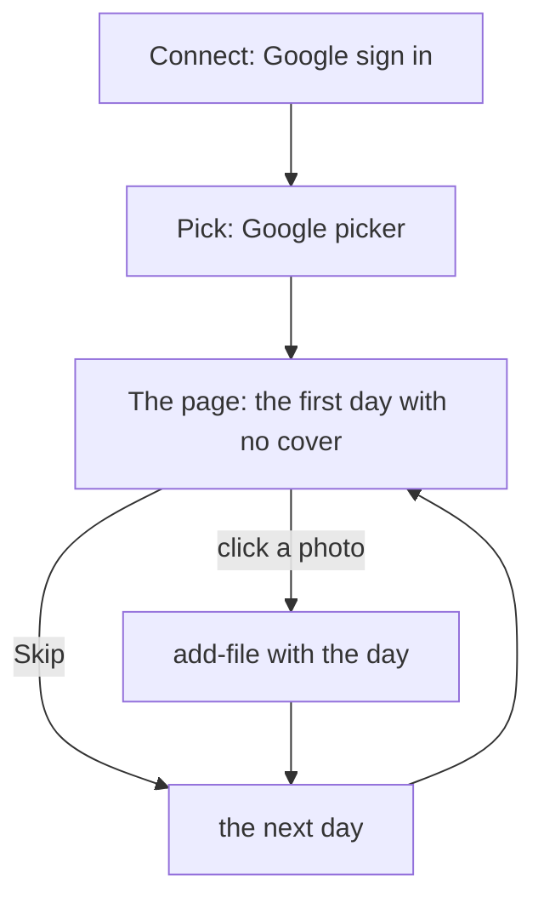

# lifelog-gphotos: a cover for each day from Google Photos

`lifelog-gphotos` is a small local web page. You pick photos in Google Photos. The page shows each day that has no
cover, with the photos of that day. One click keeps a photo as the cover of the day.

It is a client of the lifelog HTTP API ([API.md](../../API.md)). It is a separate Go module, `lifelog-googlephotos`. It
uses the standard library only. It imports nothing from lifelog, and `lifelog` does not change.



## Set up Google, once

Google gives an outside app no access to the whole library. The app reads only the photos that you pick in the
Google picker (2000 for each pick at most). So you make your own OAuth client.

1. In the [Google Cloud console](https://console.cloud.google.com/), make a project.
2. Enable the **Google Photos Picker API** for the project.
3. In the OAuth consent screen, choose the type External, keep the status **Testing**, and add your Google account as
   a test user.
4. Make an OAuth client of the type **Desktop app**. Download its JSON.
5. Save the JSON as `credentials.json` in the config folder of the extension (for example
   `~/.config/lifelog-gphotos/credentials.json` on Linux), or give its path with `--credentials`.

An app in Testing status loses its refresh token after 7 days. Then press "Sign in again" on the page.

## Build and run

```
cd extensions/googlephotos
go build -o lifelog-gphotos ./cmd/lifelog-gphotos
./lifelog-gphotos
```

Open `http://127.0.0.1:7790`.

| flag | meaning |
|---|---|
| `--addr` | where the page listens. Default `127.0.0.1:7790`. Only a loopback address is allowed. |
| `--url` | the address of lifelog. Default `http://127.0.0.1:7777`. When `$LIFELOG_TOKEN` is set, it is sent as a bearer token. |
| `--credentials` | the JSON of the Desktop OAuth client. Default: `credentials.json` beside the token file. |
| `--zone` | the IANA zone that gives the day of a photo. Default: the local zone. |

lifelog needs no new build and no restart.

## What to do on the page

1. Press **Connect Google Photos** and sign in.
2. Press **Pick photos**. Open the Google picker, choose the photos (for example, one month), and press Done there.
   The page sorts the photos by day.
3. For each day that has no cover, click the photo to use, or press **Skip this day**.
4. Press **Close this session** when the page says Done.

A day with no day page gets one. A day that has a cover is not shown, and it is never written. The page reads the day
again just before each write, so a cover that you set in lifelog at the same time is kept.

## What it keeps and what it does not keep

- The file is kept through `add-file` with the writer `import:google-photos`. Its title is `<day>.jpg`, then
  `<day> 2.jpg` and so on when another file holds the title. The same photo sent again writes nothing.
- The download is the copy of Google, without the place. It is not the byte-exact original, so its hash is not the
  hash of the original on your phone. lifelog keeps the small picture and the hash only
  ([D9](../../docs/decisions/D09-binary-files.md)).
- A video is skipped.
- The picked photos and the days to do are in memory only. After a restart, pick again.
- The only file on disk is the OAuth token: `lifelog-gphotos/token.json` in the user config folder, mode 0600.
- The logs hold no token and no bytes of a photo.

## Checks

```
cd extensions/googlephotos
gofmt -l .
go vet ./...
go test ./...
staticcheck ./...
govulncheck ./...
```

The end-to-end test builds the real `lifelog` from this repository, runs it on a new `life.db` in a temporary folder,
and uses a fake Google. `go test -short` skips it.
