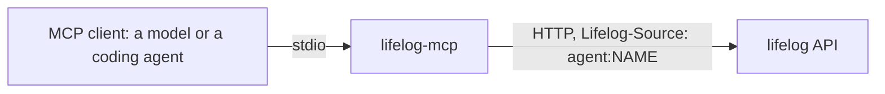

# lifelog-mcp

`lifelog-mcp` is the MCP server of lifelog. It serves the action catalog of the API (`GET /actions`) as MCP tools on
stdio, for a model or a coding agent.

It is a client of the lifelog HTTP API ([API.md](../../API.md)). It is a separate Go module, `lifelog-mcp`. It uses the
standard library and the [MCP Go SDK](https://github.com/modelcontextprotocol/go-sdk). It imports `lifelog/siren`,
`lifelog/client` and `lifelog/client/tools` of the root module (a `replace` directive), and nothing of
`lifelog/internal`. `lifelog` does not change when it does.



- Each action of the catalog that is not the owner's is one tool. The tool name is the action name with `_` for `-`.
- The owner-only actions (the ones the catalog marks `owner`) are
  never tools. The API refuses them to an `agent:*` writer as well.
- The tool `get` follows a link: it fetches the resource at an `href` of an earlier result.
- A file field takes the absolute path of a local file. The server streams the file to the API.
- Every result is the Siren entity of the API, with its links and actions. An error is a result with `isError` set,
  and its text is the error entity (`code`, `message`).
- The server writes as `agent:NAME`. `--source` is refused.

## Build

```
go build -o lifelog-mcp ./cmd/lifelog-mcp
```

From the repository root: `go build -C extensions/mcp -o ../../lifelog-mcp ./cmd/lifelog-mcp`. Put `lifelog-mcp`
beside `lifelog`.

## Run

| line | what happens |
|---|---|
| `lifelog mcp [--agent NAME] [--db FILE]` | `lifelog` finds `lifelog-mcp` beside itself, serves the file on a temporary loopback server, and runs the extension against it ([extensions/README.md](../README.md)). |
| `lifelog-mcp [--agent NAME] --url URL` | It talks to a running `lifelog serve` at `URL` (default `$LIFELOG_URL`). With neither, it refuses: a guessed address could be another file's server. |

`--agent` defaults to `mcp`. `$LIFELOG_TOKEN` is sent as a bearer token when it is set (a `--public` server needs it).

An MCP client starts it with a line such as:

```
<path>/lifelog mcp --agent claude --db <path>/life.db
```

## Tests

`go vet ./... && go test ./...` in this folder. The tests of `mcp/` run on a fake catalog. `e2e_test.go` builds the
real `lifelog` and `lifelog-mcp` into one folder, and runs `lifelog mcp --agent test` through the command transport of
the SDK. It needs the `go` command and the sources of the repository.
