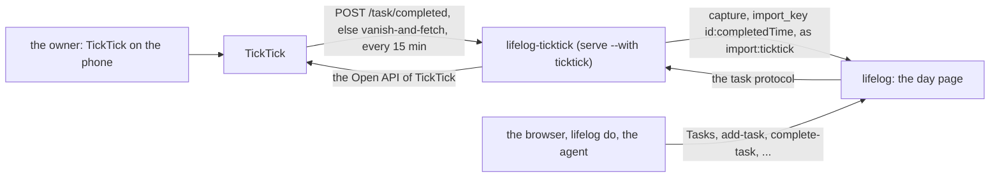
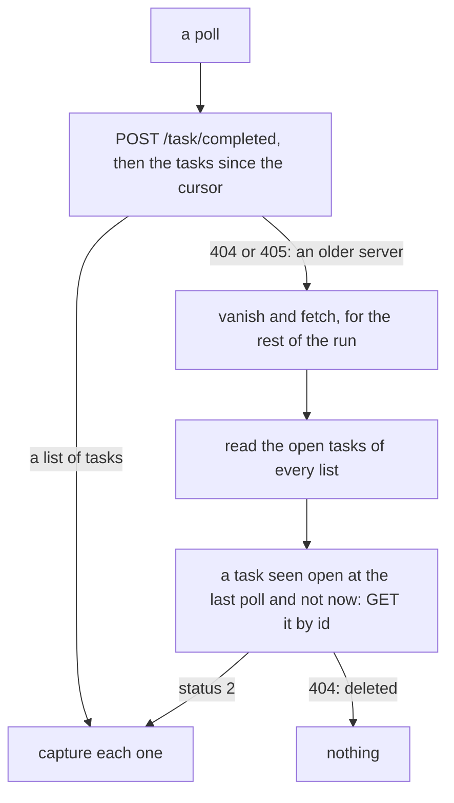

# lifelog-ticktick: TickTick, the task service

`lifelog-ticktick` links TickTick to your life log in two ways. What you finish in TickTick comes back as an entry of
its day: `Done: Pay rent · Home`. And it is the **task service** of `lifelog`: `lifelog` draws your TickTick tasks as
the section Tasks, and it adds, edits, completes, reopens and deletes them through this program.

It is an extension that `lifelog serve --with ticktick` runs. It serves the task protocol of
[a task service](../README.md#a-task-service) and no page: `lifelog` builds the pages. It is a separate Go module,
`lifelog-ticktick`. It imports `lifelog/siren`, `lifelog/client` and `lifelog/app` of the root module (a `replace`
directive), and uses the standard library for TickTick and for OAuth2. `lifelog` does not change.



## Set up TickTick, once

TickTick gives an outside app access only through an app that you register.

1. Open the [developer console](https://developer.ticktick.com/manage) and sign in.
2. Make an app. Set its redirect URL to `http://127.0.0.1:8765/callback`.
3. Keep the **client id** and the **client secret** of the app.

The Open API of TickTick is used as its reference describes it. No test of this repository reaches TickTick: the
first live login and the first sync are yours to check.

## Log in

```
lifelog ticktick login
```

The program asks for the client id and the client secret. The terminal may show what you type. To avoid the questions,
give `--client-id` and `--client-secret`. The flag `--port` changes the port of the redirect (8765 by default); the
redirect URL in the console must then change too.

The program prints an address. Open it in a browser and agree. TickTick sends the browser to
`http://127.0.0.1:8765/callback`, and the program takes the code, trades it for a token and ends. No browser is opened by
the program.

When the program runs on a server and the browser on another machine, the browser lands on the `127.0.0.1` of that
other machine, where nothing listens. Copy the address of the page it landed on
(`http://127.0.0.1:8765/callback?code=...&state=...`), paste it into the terminal of the program and press Enter: the
program takes the code from it, with the same check of `state`.

It writes two files in `~/.config/lifelog-ticktick/` (`os.UserConfigDir()/lifelog-ticktick/`):

| file | what it holds |
|---|---|
| `token.json` | the access token, mode 0600. The token is long lived. There is no refresh flow. |
| `config.json` | written with these defaults when it is missing. You may edit it: `api` (`https://api.ticktick.com/open/v1`), `authorize_url` (`https://ticktick.com/oauth/authorize`), `token_url` (`https://ticktick.com/oauth/token`), `poll` (a duration, `15m`). A user of the Dida365 variant changes the three URLs. |
| `state.json` | the cursor and the open tasks seen, written by the program. |

When TickTick refuses the token (status 401), the program says `login again: lifelog ticktick login` and ends with status
2. `serve` then does not start it again until you log in and restart `serve`.

## Build and run

From the root of the repository, beside `lifelog`:

```
go build -C extensions/ticktick -o ../../lifelog-ticktick ./cmd/lifelog-ticktick
lifelog ticktick sync --url http://127.0.0.1:7777     # one poll now: prints "wrote N entries"
lifelog serve --with ticktick                          # the task service beside the server, and a poll every 15 minutes
```

| command | what it does |
|---|---|
| `lifelog ticktick login [--client-id ID] [--client-secret SECRET] [--port N]` | the login above |
| `lifelog ticktick sync [--url URL]` | one poll. The address is `--url`, else `$LIFELOG_URL`. With neither, it refuses. When `$LIFELOG_TOKEN` is set, it is sent as a bearer token. |
| `lifelog serve --with ticktick` | the program with no argument and with `LIFELOG_LISTEN` set: it serves the task protocol, polls once at the start, then every `poll`. Without `LIFELOG_LISTEN` it prints the usage and exits 2. |

An unknown argument or flag is refused. Exit status 1 is an error (`serve` starts the program again after 10 seconds).
Exit status 2 means that you act first: the login is missing or refused, or the usage is wrong.

## What comes back

Each task that you complete in TickTick is one `capture` on a day page, as the writer `import:ticktick`.

| part | rule |
|---|---|
| the text | `Done: TITLE`, or `Done: TITLE · LIST` when the task is not in the Inbox. `lifelog` puts `(HH:MM, via ticktick)` before it. |
| the day | the day of `completedTime`, in the zone of the task (else in the local zone) |
| the key | `import_key` is the id of the task, a colon, and `completedTime` as TickTick gives it. A task that repeats and is done twice is two entries. A resend writes nothing ([imports](../../docs/contract/imports.md)). |

Nothing else of a task enters the file: the file is the log of what you did. Open tasks, notes and due dates stay in
TickTick.

The program finds the done tasks in one of two ways. It picks one while it runs.



- **The first way** asks for the done tasks and keeps the ones since the cursor. The live server answers an empty list
  to every date filter it was sent (probed 2026-10-29) and the whole list to an empty body, so the filter is the connector's. The cursor is the newest `completedTime` seen, minus one
  day. The overlap costs one request, and the keys make it safe. The first poll, with no cursor, keeps the last 30
  days. A first sync does not import a lifetime: your log starts where the connector starts.
- **The second way** is for a server without `/task/completed`. It keeps the ids of the open tasks. A task that
  left its list is read by its id. This way has two limits: a task that you make and finish between two polls is not
  seen, and the tasks of the Inbox are not listed, because the API lists only the lists. The first way has neither.

A failed poll changes nothing. The next poll comes after the interval, and `lifelog do sync-tasks --url URL` is your retry.

## The task service

The program serves the protocol of [a task service](../README.md#a-task-service). The contract is there and is not
restated here. This table says only how TickTick fills it.

| part of the protocol | in TickTick |
|---|---|
| `GET /lists` | `GET /project`. The ids are the project ids. The list is read when the program starts, so a new list needs a restart. |
| `GET /open` | `GET /project/ID/data` for each list. |
| `GET /done?since=` | `POST /task/completed` with an empty body, filtered here by the day of `completedTime`. `done_day` is the day that the entry of the task uses: one rule, the zone of the task. A server without that call gives an empty list. |
| `GET /tasks/ID` | the task is looked up in the lists, then in the done tasks. |
| `POST /tasks` | `POST /task`. `list` is a project id. Without it, the task goes to the Inbox. |
| `POST /tasks/ID` (edit) | `GET` the task, then `POST /task/ID` with the whole task as TickTick gave it (priority, tags, reminders and the rest stay). A field that the request does not name keeps its value. |
| `.../complete`, `.../reopen`, `.../delete` | `POST .../complete`, `POST /task/ID` with status 0, `DELETE /project/P/task/ID`. |
| `POST /sync` | one poll. It answers the count that it wrote. A `sync` that comes while a poll runs waits for it. |

The task `list` is the project id, and `""` for the Inbox. `due` is the due day in the zone of the task. A due day that
you set is a whole day: `dueDate` and `startDate` are the same instant, `isAllDay` is true. The zone name is the `timeZone` of the task when it loads; else `TZ`, else the target of `/etc/localtime`; else no `timeZone` is sent. TickTick has priorities, but the protocol has none, so they are not
read. The refusals: a `due` that is not `YYYY-MM-DD` and a `list` that is not a list are 422; an unknown task or list is
404; an answer of TickTick that is not 2xx is 502 `upstream` with the words `the task manager answered STATUS` and never
TickTick's body or name.

How you reach it:

- In the browser: the rail entry Tasks. Today, Next 7 days, a page for each list, Done and one page for each task.
- On the command line: `lifelog do add-task title=Milk list=Home --url URL`, and `complete-task`, `edit-task`,
  `reopen-task`, `delete-task` and `sync-tasks` the same way. The MCP tools have the same names with `_`.

The names `ticktick-*` and the address `/with/ticktick` do not exist. `lifelog` does not know which task manager it
serves.

**The Inbox has a limit.** The `/project` call of TickTick does not list the Inbox, so its open tasks are not browsable.
A task made without a list goes to the Inbox. You reach it by its own address, in the run that made it. After a restart
the program does not know where the task is, and the task is not found.

**Reopen and clear are not tested live.** Reopen is `POST /task/ID` with `status` 0. Clearing a due day or the notes
sends the field empty. The Open API is used as its reference describes it, but no test reaches it. A fake stands for
TickTick. Check both once on your own account: reopen a done task, and clear the due day of a task. The first live
reopen and edit are yours to check.

## Run it

Run it beside the server:

```
lifelog serve --with ticktick
```

A unit with `ProtectHome=read-only` must let the program write its state folder:
`ReadWritePaths=/home/OWNER/.config/lifelog-ticktick`. Without it the program fails at its start and `serve` starts it
again every 10 seconds ([deploy/lifelog.service](../../deploy/lifelog.service)). `serve` logs the line
`with ticktick: the task service, N lists, on ...` when the service is up.

With no `token.json`, the program serves no catalog: it logs the login line and ends with status 2.

## Tests

```
cd extensions/ticktick
gofmt -l .
go vet ./...
go test ./...
staticcheck ./...
```

- `ticktick`: every call against an `httptest` fake, the 404 of `Completed`, a 401, the instant in a zone, the OAuth2
  exchange.
- `connector`: the mapping of a task to its day, text and key (a zone that crosses midnight), both ways to find the done
  tasks, the cursor, the lock, the task protocol (each route and write, the edit rule, the Inbox, `since`, the marker
  class) and its refusals.
- `cmd/lifelog-ticktick`: the usage, the refusals and the login against a fake token endpoint.
- `e2e_test.go` builds the real `lifelog` and `lifelog-ticktick`, runs `lifelog serve --with ticktick` on a new
  `life.db` in a temporary folder (with `XDG_CONFIG_HOME` there too) and a fake TickTick, once with `/task/completed` and
  once without it. It reads the pages Tasks and a list as HTML (no word TickTick), posts the round Complete form, and checks that
  `/with/ticktick/` is 404. It also checks that a refused token ends the app with status 2. `go test -short` skips it.

No test calls TickTick, and none opens your `life.db`.
