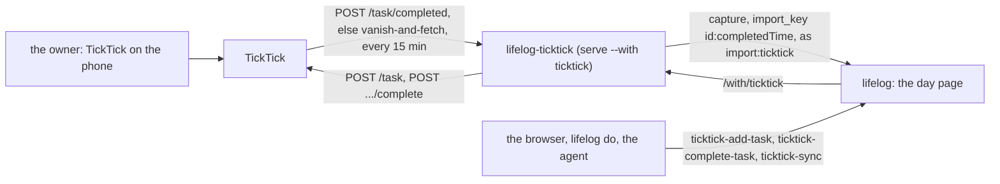
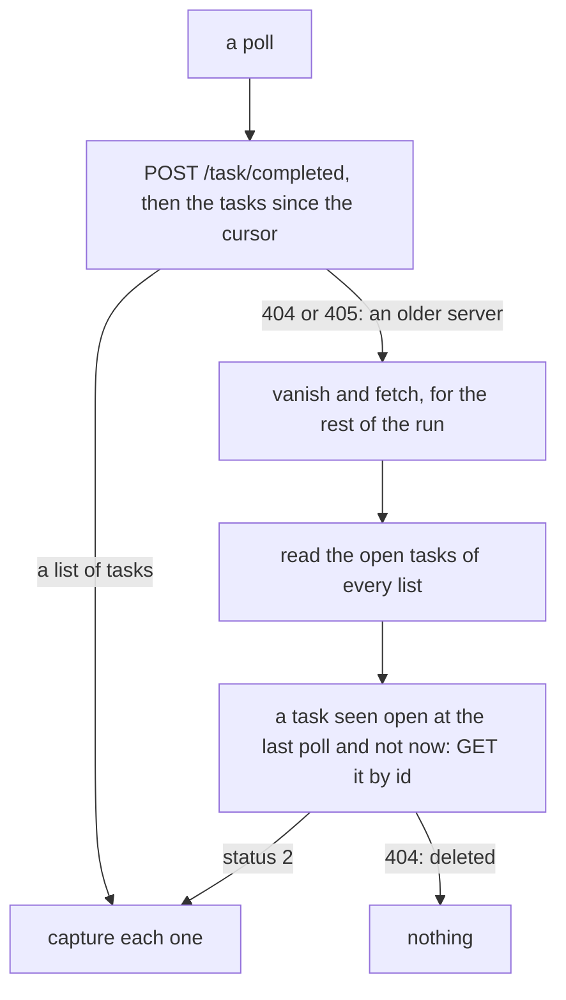

# lifelog-ticktick: TickTick, the first connected app

`lifelog-ticktick` links TickTick to your life log in two ways. What you finish in TickTick comes back as an entry of
its day: `Done: Pay rent · Home`. And `lifelog` gets three actions, so that you, an agent or the browser can add a task,
complete a task and sync now.

It is a connected app: an extension that `lifelog serve --with ticktick` runs, and that serves a catalog of its own
([a catalog of its own](../README.md#a-catalog-of-its-own)). It is the worked example of that contract. It is a separate
Go module, `lifelog-ticktick`. It imports `lifelog/siren`, `lifelog/client` and `lifelog/app` of the root module (a
`replace` directive), and uses the standard library for TickTick and for OAuth2. `lifelog` does not change.



## Set up TickTick, once

TickTick gives an outside app access only through an app that you register.

1. Open the [developer console](https://developer.ticktick.com/manage) and sign in.
2. Make an app. Set its redirect URL to `http://127.0.0.1:8765/callback`.
3. Keep the **client id** and the **client secret** of the app.

The Open API of TickTick is used as its reference describes it. No test of this repository reaches TickTick: the
first live login and the first sync are yours to check.

## Log in

```
lifelog ticktick login
```

The program asks for the client id and the client secret. The terminal may show what you type. To avoid the questions,
give `--client-id` and `--client-secret`. The flag `--port` changes the port of the redirect (8765 by default); the
redirect URL in the console must then change too.

The program prints an address. Open it in a browser and agree. TickTick sends the browser to
`http://127.0.0.1:8765/callback`, and the program takes the code, trades it for a token and ends. No browser is opened by
the program.

When the program runs on a server and the browser on another machine, the browser lands on the `127.0.0.1` of that
other machine, where nothing listens. Copy the address of the page it landed on
(`http://127.0.0.1:8765/callback?code=...&state=...`), paste it into the terminal of the program and press Enter: the
program takes the code from it, with the same check of `state`.

It writes two files in `~/.config/lifelog-ticktick/` (`os.UserConfigDir()/lifelog-ticktick/`):

| file | what it holds |
|---|---|
| `token.json` | the access token, mode 0600. The token is long lived. There is no refresh flow. |
| `config.json` | written with these defaults when it is missing. You may edit it: `api` (`https://api.ticktick.com/open/v1`), `authorize_url` (`https://ticktick.com/oauth/authorize`), `token_url` (`https://ticktick.com/oauth/token`), `poll` (a duration, `15m`). A user of the Dida365 variant changes the three URLs. |
| `state.json` | the cursor and the open tasks seen, written by the program. |

When TickTick refuses the token (status 401), the program says `login again: lifelog ticktick login` and ends with status
2. `serve` then does not start it again until you log in and restart `serve`.

## Build and run

From the root of the repository, beside `lifelog`:

```
go build -C extensions/ticktick -o ../../lifelog-ticktick ./cmd/lifelog-ticktick
lifelog ticktick sync --url http://127.0.0.1:7777     # one poll now: prints "wrote N entries"
lifelog serve --with ticktick                          # the app beside the server: the catalog and a poll every 15 minutes
```

| command | what it does |
|---|---|
| `lifelog ticktick login [--client-id ID] [--client-secret SECRET] [--port N]` | the login above |
| `lifelog ticktick sync [--url URL]` | one poll. The address is `--url`, else `$LIFELOG_URL`. With neither, it refuses. When `$LIFELOG_TOKEN` is set, it is sent as a bearer token. |
| `lifelog serve --with ticktick` | the program with no argument and with `LIFELOG_LISTEN` set: it serves the catalog, polls once at the start, then every `poll`. Without `LIFELOG_LISTEN` it prints the usage and exits 2. |

An unknown argument or flag is refused. Exit status 1 is an error (`serve` starts the program again after 10 seconds).
Exit status 2 means that you act first: the login is missing or refused, or the usage is wrong.

## What comes back

Each task that you complete in TickTick is one `capture` on a day page, as the writer `import:ticktick`.

| part | rule |
|---|---|
| the text | `Done: TITLE`, or `Done: TITLE · LIST` when the task is not in the Inbox. `lifelog` puts `(HH:MM, via ticktick)` before it. |
| the day | the day of `completedTime`, in the zone of the task (else in the local zone) |
| the key | `import_key` is the id of the task, a colon, and `completedTime` as TickTick gives it. A task that repeats and is done twice is two entries. A resend writes nothing ([imports](../../docs/contract/imports.md)). |

Nothing else of a task enters the file: the file is the log of what you did. Open tasks, notes and due dates stay in
TickTick.

The program finds the done tasks in one of two ways. It picks one while it runs.



- **The first way** asks for the done tasks and keeps the ones since the cursor. The live server answers an empty list
  to every date filter it was sent (probed 2026-10-29) and the whole list to an empty body, so the filter is the connector's. The cursor is the newest `completedTime` seen, minus one
  day. The overlap costs one request, and the keys make it safe. The first poll, with no cursor, keeps the last 30
  days. A first sync does not import a lifetime: your log starts where the connector starts.
- **The second way** is for a server without `/task/completed`. It keeps the ids of the open tasks. A task that
  left its list is read by its id. This way has two limits: a task that you make and finish between two polls is not
  seen, and the tasks of the Inbox are not listed, because the API lists only the lists. The first way has neither.

A failed poll changes nothing. The next poll comes after the interval, and `lifelog do ticktick-sync` is your retry.

## The actions

The merged catalog of `lifelog` has three actions. Each is on every surface, none is owner-only, so an agent may use
them.

| action | what it does | CLI | MCP tool |
|---|---|---|---|
| `ticktick-add-task` | makes a task: `title` (required), `list` (a name from the options, else the Inbox), `due` (`YYYY-MM-DD`), `notes` | `lifelog do ticktick-add-task title=Milk list=Home --url URL` | `ticktick_add_task` |
| `ticktick-complete-task` | completes the task with this `id` | `lifelog do ticktick-complete-task id=ID --url URL` | `ticktick_complete_task` |
| `ticktick-sync` | does one poll now and answers the home with the count that it wrote | `lifelog do ticktick-sync --url URL` | `ticktick_sync` |

The browser draws the home of the app at `/with/ticktick/`: the lists, the number of open and overdue tasks, the tasks
due today or before (each is a page with its complete button), and the two forms. The refusals: a `due` that is not
`YYYY-MM-DD` and a `list` that is not a list are 422; an unknown task is 404; an answer of TickTick that is not 2xx is
502 `upstream` with the words `TickTick answered STATUS` and never TickTick's body. The home lists the open tasks of the
lists, not of the Inbox.

A `sync` that comes while a poll runs waits for it. The timer and the action share one lock.

## The service

Run it beside the server:

```
lifelog serve --with ticktick
```

A unit with `ProtectHome=read-only` must let the program write its state folder:
`ReadWritePaths=/home/OWNER/.config/lifelog-ticktick`. Without it the program fails at its start and `serve` starts it
again every 10 seconds ([deploy/lifelog.service](../../deploy/lifelog.service)). `serve` logs the line
`with ticktick: a catalog of 3 actions on ...` when the app is up.

With no `token.json`, the app serves no catalog: it logs the login line and ends with status 2.

## Tests

```
cd extensions/ticktick
gofmt -l .
go vet ./...
go test ./...
staticcheck ./...
```

- `ticktick`: every call against an `httptest` fake, the 404 of `Completed`, a 401, the instant in a zone, the OAuth2
  exchange.
- `connector`: the mapping of a task to its day, text and key (a zone that crosses midnight), both ways to find the done
  tasks, the cursor, the lock, the catalog and its refusals.
- `cmd/lifelog-ticktick`: the usage, the refusals and the login against a fake token endpoint.
- `e2e_test.go` builds the real `lifelog` and `lifelog-ticktick`, runs `lifelog serve --with ticktick` on a new
  `life.db` in a temporary folder (with `XDG_CONFIG_HOME` there too) and a fake TickTick, once with `/task/completed` and
  once without it. It also checks that a refused token ends the app with status 2. `go test -short` skips it.

No test calls TickTick, and none opens your `life.db`.
