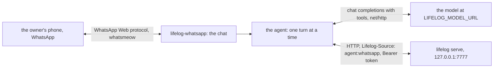

# lifelog-whatsapp

`lifelog-whatsapp` is an always-on agent for lifelog. The owner writes to it on WhatsApp. A model answers. The model
reads and writes `life.db` through the action catalog of the API, as the [MCP server](../mcp/README.md) offers it.

It is a client of the lifelog HTTP API ([API.md](../../API.md)). It is a separate Go module, `lifelog-whatsapp`. It
imports nothing from lifelog, and `lifelog` does not change when it does. It writes as `agent:whatsapp`. The API
refuses the owner-only actions to such a writer.



## How it works

- **One conversation a day, and it is a page.** The page `Conversation YYYY-MM-DD` (the local day of the machine) is
  made on the first turn of the day, in the category `Conversations`. Its first line is `[[YYYY-MM-DD]]`, so the day
  page lists it. A message from the phone is added as `**Owner** (HH.MM): text`. The tool calls and the reply are
  added as lines and `**lifelog** (HH.MM): text`. The model reads the whole page on each turn. The extension keeps
  nothing else of the conversation.
- **Continued anywhere.** Every 3 seconds the extension reads today's page. Text added to its end on another surface
  (the browser, `lifelog do save-body`, an MCP tool) is an owner's turn: the reply is added to the page and sent on
  WhatsApp. Any other change of the page is adopted and answered with nothing.
- **Earlier days** are pages. The model reads them with `get` on `/pages?title=Conversation%20YYYY-MM-DD`.
- **One number may talk.** A message from any other number, and any group message, is logged and ignored. A photo,
  a voice note or a document from the owner gets one line: the agent reads text for now.
- **A reply only.** The agent sends nothing on its own.
- A turn has at most 16 model steps and 5 minutes. Up to 32 messages wait for the turn in progress.

## The second number

The transport is [whatsmeow](https://github.com/tulir/whatsmeow), the Go client of the unofficial WhatsApp Web
protocol. WhatsApp may ban a number that uses it, and the protocol may change. Use a number that is the agent's own,
never the owner's main number. The owner writes to the agent's number from the main number.

## Build

```
go build -o lifelog-whatsapp ./cmd/lifelog-whatsapp
```

From the repository root: `go build -C extensions/whatsapp -o ../../lifelog-whatsapp ./cmd/lifelog-whatsapp`. Put
`lifelog-whatsapp` beside `lifelog`. The build needs no cgo.

## Run

| line | what happens |
|---|---|
| `lifelog whatsapp login` | Pairs the agent's number. It draws a QR code. On the agent's phone, open WhatsApp, Linked devices, Link a device, and scan it. The session is saved. It exits. It needs nothing else. |
| `lifelog whatsapp --owner NUMBER [--db FILE]` | Serves: answers the owner on WhatsApp. `lifelog` serves the file on a temporary loopback server for it ([extensions/README.md](../README.md)). |
| `lifelog-whatsapp --owner NUMBER --url URL [--token-file F]` | The same against a running `lifelog serve` at `URL` (default `$LIFELOG_URL`). With neither, it refuses: a guessed address could be another file's server. |
| add `--terminal` | Answers on the terminal: a line of input is a message of the owner, a reply is written to the output. It needs no WhatsApp session. Use it to try the agent without a phone. |

| flag | meaning |
|---|---|
| `--owner` | The number of the owner: digits with the country code, such as `40712345678`. Required to serve. |
| `--url` | The address of lifelog. Default `$LIFELOG_URL`. |
| `--token-file` | A file with the bearer token. `$LIFELOG_TOKEN` wins when it is set. |
| `--terminal` | Answer on the terminal. |

`--source` is not a flag: the extension always writes as `agent:whatsapp`.

| environment | meaning |
|---|---|
| `LIFELOG_MODEL_URL` | The base URL of a server that speaks the OpenAI chat-completions protocol, ending in `/v1`. Required to serve. |
| `LIFELOG_MODEL` | The model id. Required to serve. |
| `LIFELOG_MODEL_KEY` | A bearer credential for the model server. Optional. It is never a flag and never in a log line. |
| `LIFELOG_URL`, `LIFELOG_TOKEN` | Set by `lifelog whatsapp`, or by the owner. |

The state folder is `os.UserConfigDir()/lifelog-whatsapp/` (mode 0700). It holds `session.db` (mode 0600), the
store of the keys of the account, and `state.json`, the id, the version and the body of the conversation page after
the extension's own last save. To pair again, delete `session.db`.

## Exit codes

| code | meaning |
|---|---|
| 0 | An interrupt or SIGTERM, or (with `--terminal`) the end of the input. |
| 1 | An error. |
| 2 | Not paired: run `lifelog whatsapp login`. |
| 3 | Logged out: the owner unlinked the device on the phone. |

## The unit

This unit runs the agent beside `lifelog.service`. `whatsapp.env` has mode 0600 and holds `LIFELOG_MODEL_URL`,
`LIFELOG_MODEL` and `LIFELOG_MODEL_KEY`. Run `lifelog whatsapp login` once, as the same user, before the unit starts.

```ini
[Unit]
Description=lifelog WhatsApp agent
After=network-online.target lifelog.service
Wants=lifelog.service

[Service]
User=cico
Group=cico
EnvironmentFile=/home/cico/life/whatsapp.env
ExecStart=/home/cico/.local/bin/lifelog whatsapp --url http://127.0.0.1:7777 --token-file /home/cico/life/token --owner NUMBER
Restart=always
RestartSec=10
RestartPreventExitStatus=2 3
KillSignal=SIGTERM
TimeoutStopSec=30
NoNewPrivileges=true
PrivateTmp=true
ProtectSystem=strict
ProtectHome=read-only
ReadWritePaths=/home/cico/.config/lifelog-whatsapp

[Install]
WantedBy=multi-user.target
```

## Privacy

- The text of the chat, and the text of the pages that the model reads, go to the model server that the owner
  configures. A hosted model sees them.
- The conversation pages are in `life.db`, so every snapshot of it holds them.
- The session store holds the keys of the account. Keep the state folder private and out of git.
- A model writes with no approval step. Its rows carry `agent:whatsapp`. Nothing is ever deleted.

## Tests

`go vet ./... && go test ./...` in this folder. The tests of `agent/` run on a fake catalog, a fake model and a fake
chat. `e2e_test.go` builds the real `lifelog` and `lifelog-whatsapp` into one folder and runs
`lifelog whatsapp --terminal` against a fake model. It needs the `go` command and the sources of the repository.

**What has no test:** the connection to WhatsApp (`login`, the connection, `Send`, `Typing`, `MarkRead`, the
`LoggedOut` event). It needs a real number. The filter, the QR renderer and the state folder have tests.
