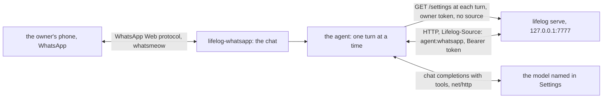

# lifelog-whatsapp

`lifelog-whatsapp` is an always-on agent for lifelog. The owner writes to it on WhatsApp. A model answers. The model
reads and writes `life.db` through the action catalog of the API, as the [MCP server](../mcp/README.md) offers it.

It is a client of the lifelog HTTP API ([API.md](../../API.md)). It is a separate Go module, `lifelog-whatsapp`. It
imports `lifelog/siren`, `lifelog/client` and `lifelog/client/tools` of the root module (a `replace` directive), and
nothing of `lifelog/internal`. `lifelog` does not change when it does. It writes as `agent:whatsapp`. The API
refuses the owner-only actions to such a writer.



## How it works

- **One conversation a day, and it is a page.** The core owns the convention (the page `Conversation YYYY-MM-DD`,
  its category, its first line, the paragraph of a turn: see the conversation class in [API.md](../../API.md)). A
  message from the phone goes in with the action `say` (`day` = `today`) as the owner's turn, with `via=whatsapp`. The extension reads the page with
  `GET /days/{day}/conversation` and holds no title and no category. The tool calls and the reply are added with
  `save-body`, as lines and `**lifelog** (HH:MM): text`. The model reads the whole page on each turn. The extension
  keeps nothing else of the conversation.
- **The tools are the catalog, read at each turn.** The extension reads `GET /actions` at the start of each turn and
  builds the tools of the model from it. An app that `lifelog serve --with` connects can register after the extension
  started, and its actions leave the catalog and come back when it restarts. The new tools are there at the next turn.
  A read that fails keeps the tools of the last read and writes one line in the log. At the start, a catalog with no
  `say` or no `save-body` stops the extension.
- **The model is set in lifelog.** The extension reads `GET /settings` at the start of each turn, and sends `say`, with the owner's
  token and no `Lifelog-Source`, through a second client that only these two use. Every other request, the tools of
  the model too, carries `Lifelog-Source: agent:whatsapp`, so the model's own `get /settings` is refused (403): the key
  of the model never reaches the model, the page or the phone. A change in Settings is seen
  at the next turn. With no model set, the reply of the turn is one line, "No model is set: open Settings in
  lifelog.", on the page and on the phone. The agent keeps running.
- **Continued anywhere.** Every 3 seconds the extension reads today's conversation. Text added to its end on another surface
  (the browser, `lifelog do save-body`, an MCP tool) is an owner's turn: the owner's words go to WhatsApp first,
  marked "You wrote in lifelog:", so the phone shows the same thread as the page, then the reply is added to the
  page and sent on WhatsApp. The first turn of a day on any surface is answered too: a page that is new to the extension, on a new day
  or after a restart, is answered when its last turn is the owner's, and a turn said before midnight is answered on
  its own page. Any other change of the page is adopted and answered with nothing. A body is read with its CRLF line
  endings made LF (a browser submits a textarea that way), and saved with LF. When the owner saves the page while
  the model runs, the reply is still appended after that text, and one line on WhatsApp says the text was not
  answered.
- **Earlier days** are pages. The model reads them with `get` on `/pages?title=Conversation%20YYYY-MM-DD`.
- **One number may talk.** A message from any other number, and any group message, is logged and ignored. A photo,
  a voice note or a document from the owner gets one line: the agent reads text for now. WhatsApp can deliver a
  message from a hidden id (a lid) without the number; then the sender does not match the owner's number and the
  message is logged as ignored. The log line shows the id.
- **No file.** An action with a file field (`add-file`, `set-cover`) is not a tool of the model. Its value would be
  the path of any file the process can read, and the model acts on text that any surface wrote to the page.
- **A reply only.** The agent sends nothing on its own.
- A turn has at most 16 model steps and 5 minutes. Up to 32 messages wait for the turn in progress.

## The second number

The transport is [whatsmeow](https://github.com/tulir/whatsmeow), the Go client of the unofficial WhatsApp Web
protocol. WhatsApp may ban a number that uses it, and the protocol may change. Use a number that is the agent's own,
never the owner's main number. The owner writes to the agent's number from the main number.

## Build

```
go build -o lifelog-whatsapp ./cmd/lifelog-whatsapp
```

From the repository root: `go build -C extensions/whatsapp -o ../../lifelog-whatsapp ./cmd/lifelog-whatsapp`. Put
`lifelog-whatsapp` beside `lifelog`. The build needs no cgo.

## Run

The way to run it always is the server: `lifelog serve --with whatsapp` (for the service: `lifelog serve --public
--addr 127.0.0.1:7777 --token-file F --with whatsapp`). The server starts `lifelog-whatsapp` beside itself with its own
address and token, and keeps it running. See "Run by serve" in [extensions/README.md](../README.md). The agent takes no
argument then: the settings of lifelog hold everything.

| line | what happens |
|---|---|
| `lifelog whatsapp login` | Pairs the agent's number. It draws a QR code. On the agent's phone, open WhatsApp, Linked devices, Link a device, and scan it. After the scan it waits for the connection that finishes the pairing (up to a minute), then the session is saved and it exits. It needs nothing else. Run it once, as the user of the service, before `serve --with whatsapp`. |
| `lifelog whatsapp [--db FILE]` | A try by hand: answers the owner on WhatsApp. `lifelog` serves the file on a temporary loopback server for it ([extensions/README.md](../README.md)). |
| `lifelog-whatsapp --url URL [--token-file F]` | The same against a running `lifelog serve` at `URL` (default `$LIFELOG_URL`). With neither, it refuses: a guessed address could be another file's server. |
| add `--terminal` | Answers on the terminal: a line of input is a message of the owner, a reply is written to the output. It needs no WhatsApp session and no number: the sender and the owner are both the word `terminal`. Use it to try the agent without a phone. An interrupt ends it at once; the read of the terminal is the one part of the program that is not awaited (it ends with the process). |

| flag | meaning |
|---|---|
| `--url` | The address of lifelog. Default `$LIFELOG_URL`. |
| `--token-file` | A file with the bearer token. `$LIFELOG_TOKEN` wins when it is set. |
| `--terminal` | Answer on the terminal. |

`--source` is not a flag: the extension always writes as `agent:whatsapp`.

**The owner's number is a setting.** Set `owner_number` on the Settings page of lifelog, or with
`lifelog do settings owner_number=40712345678`: the digits of the owner's phone number with the country code. The agent
reads it before it connects to WhatsApp. With none set, it logs one line, `no owner number: set it in Settings
(owner_number)`, reads the settings again every 30 seconds and connects when the number is set. A number that is set is
used for the whole run: a change needs a restart of the agent (a restart of `lifelog serve`, or of the line by hand).
There is no `--owner` flag.

The model is not set here. Set it on the Settings page of lifelog (`/settings`), or with
`lifelog do settings model_url=http://HOST/v1 model=ID model_key=KEY`. `model_url` is the base URL of a server that
speaks the OpenAI chat-completions protocol, ending in `/v1`. `model` is the model id. `model_key` is a bearer
credential for the model server, and it is optional. The settings are in a file beside `life.db` (mode 0600). The key
is never a flag, never an environment variable and never in a log line.

`LIFELOG_URL` and `LIFELOG_TOKEN` are set by `lifelog whatsapp` and by `lifelog serve --with whatsapp`, or by the owner.

The state folder is `os.UserConfigDir()/lifelog-whatsapp/` (mode 0700). It holds `session.db` (mode 0600), the
store of the keys of the account, and `state.json`, the id, the version and the body of the conversation page after
the extension's own last save. To pair again, delete `session.db`.

## Exit codes

| code | meaning |
|---|---|
| 0 | An interrupt or SIGTERM, or (with `--terminal`) the end of the input. `serve` does not start it again. |
| 1 | An error, or a failure of the connection that a new process may try again. `serve` starts it again after 10 seconds. |
| 2 | Not paired: run `lifelog whatsapp login`. `serve` does not start it again: restart `serve` after the pairing. |
| 3 | The connection ended for good: logged out (the owner unlinked the device on the phone), the session taken over by another client, the number banned for a time, or the client refused as outdated. `serve` does not start it again: act first (the line on stderr says what), then restart `serve`. |

## No unit of its own

The agent has no service unit. The unit of `lifelog serve` carries `--with whatsapp`
([`deploy/lifelog.service`](../../deploy/lifelog.service)). The model and the owner's number come from the Settings of
lifelog. Run `lifelog whatsapp login` once, as the same user, before the unit starts.

## Privacy

- The text of the chat, and the text of the pages that the model reads, go to the model server that the owner
  sets in Settings. A hosted model sees them.
- The conversation pages are in `life.db`, so every snapshot of it holds them.
- The session store holds the keys of the account. Keep the state folder private and out of git.
- A model writes with no approval step. Its rows carry `agent:whatsapp`. Nothing is ever deleted.

## Tests

`go vet ./... && go test ./...` in this folder. The tests of `agent/` run on a fake catalog, a fake model and a fake
chat. `e2e_test.go` builds the real `lifelog` and `lifelog-whatsapp` into one folder and runs
`lifelog whatsapp --terminal` (no number) against a fake model, and `lifelog serve --with whatsapp` with both real binaries. It sets the model with `lifelog do settings`, so it needs a `lifelog` that has the action. It needs the `go` command and the sources of the repository.

**What has no test:** the answer to a `say` under `lifelog serve --with whatsapp`: it needs a paired session, so the end-to-end test of `serve` holds the start, the exit 2 of an unpaired child, the line that it is not started again, and the stop by SIGTERM. The wait for the owner's number is tested in `agent/` with a fake settings client. The connection to WhatsApp (`login`, the connection, `Send`, `Typing`, `MarkRead`, the
`LoggedOut` event). It needs a real number. The filter, the QR renderer and the state folder have tests.
